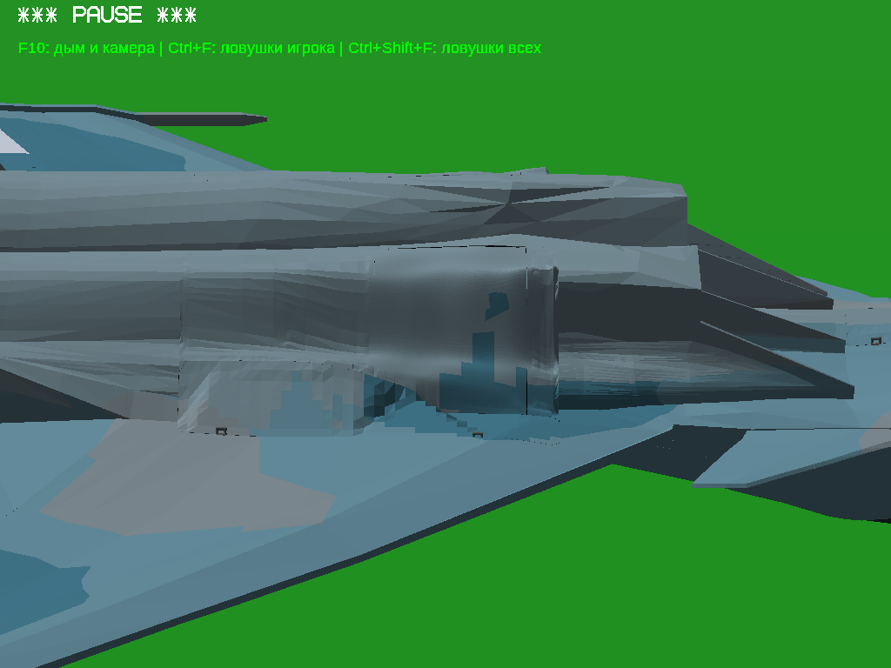
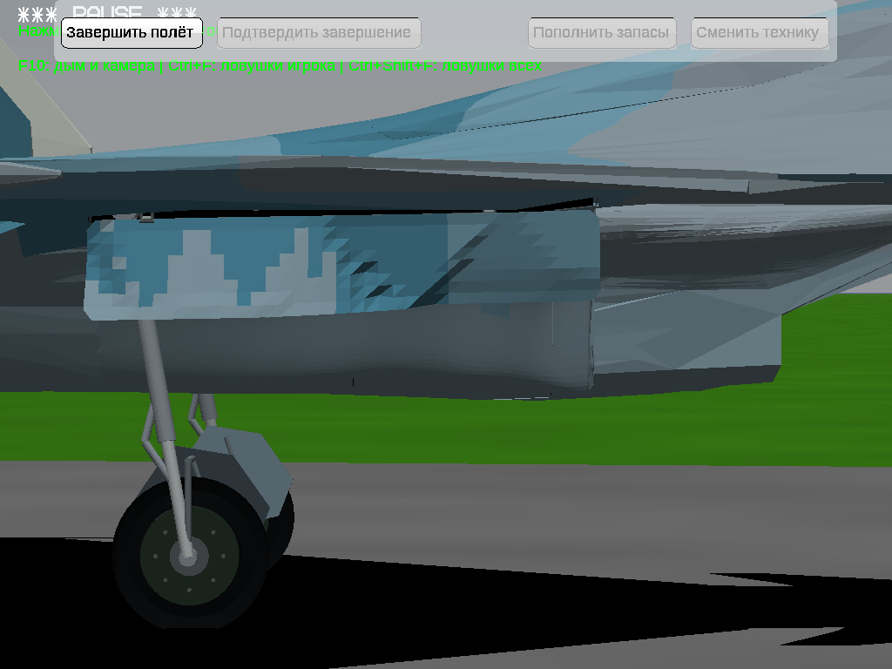

# Су-30СМ: крупные грани на обеих показанных сторонах

Включены выделенные пользователем створки. Изменены только **MainBayFixedSkin_Left/Right и MainWheelBayShutter_Left/Right**. Оси, родители, посадочные кромки, зазоры, стойки, колёса, внутренние ниши, прочие механизмы и записи анимаций сохранены. Окраска не менялась. Новая отдельная ветка `fix/su30sm-large-panels-20261113`; прежние поставки сохранены.

## Почему прежний результат не отвечал снимкам

Первый снимок показывает левую створку, которую прежняя правка не изменяла. Наземный ракурс показывает **правую** обшивку и правую створку: прежняя поставка меняла только левую неподвижную обшивку. Принадлежность подтверждена временной цветовой диагностикой в игре: [правая обшивка жёлтая, правая створка синяя](diagnostic-right-id.png). Диагностические цвета в итоговую модель не вошли.

Дополнительно обнаружен источник мелкой ряби: старый отбор `fit_field.exterior` пропускал тонкие окрашенные треугольники. Расчётная проекция получала микроскопические внутренние пробелы, и алгоритм ошибочно сохранял плавную поверхность вокруг них как вокруг края. Поэтому основная область не оставалась общей плоскостью. Новый генератор берёт все передние окрашенные треугольники, фиксирует только настоящий контур и устраняет численные пробелы проекции. Это не удаление функциональных отверстий или деталей.

## Что исправлено

[facet.py](../../changes/su30sm-large-panels/facet.py) создаёт более крупные согласованные плоскости между поперечными сечениями. Тонкие подразделения по границам камуфляжа остаются копланарными и не создают вмятин. Нормали рассчитаны из настоящей геометрии; случайные накладки и поддельные нормали не применяются.

Пробный вариант дал52 новых контакта створок с Fuselage_0_4 и был отклонён. Простая выборка высот не учитывала все границы почти вертикальных треугольников тела. В окончательном алгоритме ограничения вычисляются на пересечениях реальных треугольников, затем OSQP подгоняет целые плоскости. Сам Fuselage_0_4 не меняется. [Аудит генератора](generator.json), [контроль нормалей](normal-audit.txt).

Кромки закреплены; исходное смещение задней поверхности поY сохранено:8мм/1мм. Для крупных граней внутренние участки аппроксимированы, а не оставлены побайтово прежними: максимум проверенного отклонения высоты от чистой основы около33,9мм. Это локальная аппроксимация кривой поверхности с сохранением контура, не заводская CAD-реконструкция. Цветовые области и палитра сохранены с точностью расчётной решётки1мкм.

## Что фактически просмотрено в игре

Запущен Windows x64 OpenGL EXE под Wine. Открыты итоговые PNG с убранным шасси, близкими углами, промежуточным положением и наземным выпущенным шасси с обеих сторон. Просмотрены кадры настоящего цикла клавишейG; не заявляется просмотр всего ролика. Собственная оценка: **изменение теперь заметно на обеих нужных поверхностях, включая освещённый наземный ракурс; крупные плоскости стали ровными, прежняя мелкая рябь исчезла**.

Для каждого сравнения параметры камеры и освещения до/после одинаковы. «До» — последняя поставка8f0b40ea, «после» —91a201f3. В инвертированном воздушном fixture нижняя обшивка освещена. В обычном наземном fixture при курсе0° показанная стенка находится в тени: там контраст граней слабый, эти кадры также сохранены. Для читаемого наземного сравнения самолёт повёрнут курсом270° и камера повёрнута соответственно, сохранив ракурс относительно самолёта. Файлы LIGHTSRCD, материалы и окраска поставки не изменены. Снимки не ретушировались.

### Выделенная створка: до / после

### Выпущенное шасси, освещённая сторона: до / после

| Проверка | До | После |
|---|---|---|
| Левая сторона, убрано | [PNG](before-air/left-closed.png) | [PNG](after-air/left-closed.png) |
| Левый близкий угол | [PNG](before-air/left-near.png) | [PNG](after-air/left-near.png) |
| Правая сторона, убрано | [PNG](before-air/right-closed.png) | [PNG](after-air/right-closed.png) |
| Промежуточное, слева | [PNG](before-air/left-mid.png) | [PNG](after-air/left-mid.png) |
| Снизу | [PNG](before-air/bottom.png) | [PNG](after-air/bottom.png) |
| Наземный правый ракурс, тень | [PNG](before-ground/ground-match.png) | [PNG](after-ground/ground-match.png) |
| Наземный правый близкий | [PNG](before-ground/ground-near.png) | [PNG](after-ground/ground-near.png) |
| Наземный промежуточный | [PNG](before-ground/ground-mid.png) | [PNG](after-ground/ground-mid.png) |
| Наземный левый | [PNG](before-ground/ground-left.png) | [PNG](after-ground/ground-left.png) |
| Наземный правый, свет | [PNG](before-lit/ground-lit.png) | [PNG](after-lit/ground-lit.png) |
| Наземный правый близкий, свет | [PNG](before-lit/ground-lit-near.png) | [PNG](after-lit/ground-lit-near.png) |
| Наземный промежуточный, свет | [PNG](before-lit/ground-lit-mid.png) | [PNG](after-lit/ground-lit-mid.png) |

[Реальный цикл шасси](native/gear.mp4), [49 состояний и итог проверки](native/results.json). Цикл0→1→0 завершился, самолёт оставался активным. В этом тесте не использовалась принудительная MODELPOSE. Статические позы выше задавались диагностически для точного совпадения сравниваемых положений.

## Сохранность и регрессии

[Геометрия/защищённые SHA](quality.json), [самопересечения](self.json), [разница контактов](motion-diff.json), [сводка](summary.json).

**158 прочих PCK и все162 узла совпали дословно** с предыдущей поставкой. Четыре новые оболочки замкнуты, связны, имеют согласованный обход и характеристику Эйлера2, как чистая основа. Вырожденных треугольников, нулевых нормалей, дубликатов и самопересечений по используемым допускам не найдено. Глобальная сварка совпадающих вершин не применяется: она разрушает намеренно разделённый граничный веер исходной обшивки.

В201 позе проверены618 пар с изменёнными поверхностями.808 прежних контактных ключей сохранились; добавлено0, удалено0. Это не заявление об отсутствии всех исходных стыковых контактов самолёта и не математическое доказательство для каждого вещественного значения времени. В просмотренных ракурсах новых отверстий, выступов или наложений не обнаружено. Неровности неизменённых соседних деталей вне четырёх поверхностей не исправлялись.

## Файлы и сборки

Новые файлы: `changes/su30sm-large-panels/` (генератор, узкие проверки, упаковщик, команды, использованный capture harness), `dist/su30sm-large-panels/` (4 замороженных PCK ZIP и метаданные), `reports/su30sm-large-panels/`, `.github/workflows/su30sm-large-panels-publish.yml`. Обновлён `TASK_CONTEXT.md`. Существующий движок, физика и прочие генераторы не менялись. [Воспроизведение](../../changes/su30sm-large-panels/README.md).

Чистая геометрическая основа6f8e20b21990820dcc3aa49f91e92ef4a1771047951671f61732d111256b30c6; предыдущая поставка/откат8f0b40ea8897103c9756c1b08471d1525275adc9267030b239c0d95351257422; итог91a201f3ca02d7c69345d197827b1567cedcc87edb51409ffc0006b8cc0ae61c. Повторная локальная генерация дала побайтово тот же итог.

Два полных Windows ZIP используют прежние настоящие разные EXE: PE32 x86 и PE32+ x64. Движок не пересобирался. Меняются только модель и паспорт, добавлены инструкция и точная предыдущая модель в `runtime/rollback-large-panels/`. Все прочие записи прежнего ZIP сверяются побайтово. ModelSources содержит чистую, предыдущую и итоговую модели и код этапа. Полные неизменные исходники движка с лицензиями — в [прежнем FullSources](https://github.com/i7885784-lang/igraYS-Flight-Simulator/releases/download/su30sm-local-skin-20261111/Su30SM_LocalSkin_FullSources.zip).

Фактический игровой запуск относится к **x64 под Wine**. x86 EXE проверяется по архитектуре и ресурсам; нового игрового запуска x86 и нативной Windows не было. Это ограничение отражено в паспортах.

## Контроль опубликованных архивов

[Actions43471460180](https://github.com/i7885784-lang/igraYS-Flight-Simulator/actions/runs/43471460180) SUCCESS. ТриZIP скачаны из публичного Release: SHA256/CRC совпали; PE, итоговая модель91a, откат8f и1162 прочих записей проверены повторно в обоих игровых архивах. В ModelSources проверены все исходники и замороженные патчи побайтово, все три модели имеют ожидаемые SHA; generated совпал с ресурсом, который был открыт в игре. Локальная повторная генерация уже дала этот же91a, поэтому одинаковый исходный код повторно не запускался после скачивания. [Протокол](publication-check.json), [паспорта и SHA](packages.json).
