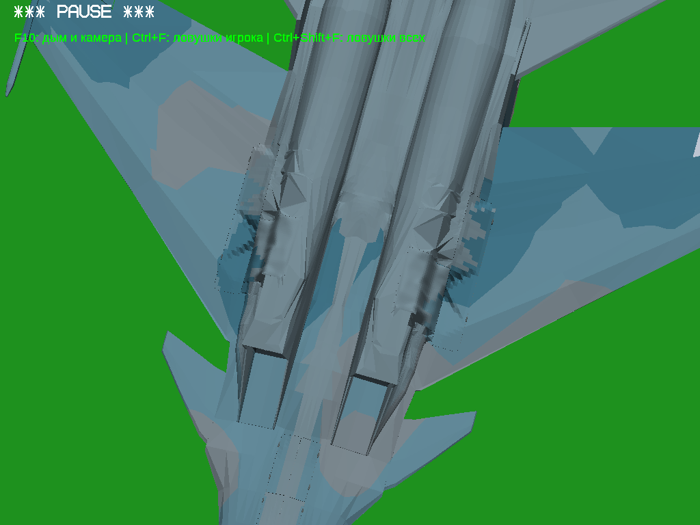

# Су-30СМ: локальная правка двух повреждённых областей

База — `work`, коммит `3d463be98234aed309c08e7f5767badf95eea61c`, исходный DNM из сохранённых `dist/su30sm-rear-seams/`. Работа выполнена в отдельной ветке `fix/su30sm-local-skin-20261111`; исходные ZIP и старые версии не заменены.

По дополнительному разрешению пользователя изменены только четыре поверхности: `MainBayFixedSkin_Left.srf`, `MainBayFixedSkin_Right.srf`, `MainWheelBayShutter_Left.srf`, `MainWheelBayShutter_Right.srf`. Створки сохранены отдельными работающими деталями. Стойки, колёса, внутренние ниши, воздухозаборники, остальные створки и механизмы не изменены.

## Подтверждённые причины

1. `changes/su30sm-rear-seams/repair.py`, строки 10–82: исходная обшивка проецировалась в X/Z, высоты разных пространственных участков смешивались, затем несогласованная Delaunay-триангуляция соединяла их. Получались большие треугольные пирамиды на неподвижных `MainBayFixedSkin`. Диагностическое скрытие именно этой пары убирало пирамиды; это способ локализации, в поставке детали не скрыты.
2. Там же, строки 87–112: подгонка высот границы переносила дефект на `MainWheelBayShutter`. Например, слева точки `(-1.4938,-0.7637231,-0.662)` и `(-1.4949,-0.49972,-0.662)` дают перепад **264,003 мм** по Y при изменении X всего **1,1 мм**. В сохранённой поверхности до плохой подгонки локальная разница интерполированных высот около 5,25 мм. При диагностическом отключении створок соответствующая складка исчезала, а в промежуточной позе двигалась вместе со створкой. [Измерения](profile-cause.txt), [аудит исходной модели](diagnostic-audit.json).
3. Исходные четыре сетки не содержали точных дубликатов полигонов и вырожденных треугольников; нормали соответствовали обходу (минимальный скалярный продукт около 0,9999366). Поэтому простая перестановка нормалей не устраняла причину. Не все видимые треугольники были ошибками: обычные грани и границы камуфляжа сохранены.

Старое соединение в `join_static.py` по ближайшей точке всего Fuselage не различает слои поверхности и потенциально способствует плохим швам. Это дополнительная гипотеза, а не отдельно доказанный источник каждой тёмной линии. Глобальный Z-fighting всего самолёта не объявляется доказанной причиной: установлена конкретная ошибка геометрии и высот четырёх разрешённых деталей.

## Исправление генератора

Новый локальный этап: [repair.py](../../changes/su30sm-local-skin/repair.py), [fit_field.py](../../changes/su30sm-local-skin/fit_field.py), [инструкция воспроизведения](../../changes/su30sm-local-skin/README.md).

- `fit_field.py:26` сохраняет исходные краевые высоты плавной привязкой. `Field` использует исходную нижнюю обшивку и сохранённые створки до плохой подгонки как опорные данные. Кубический тензорный B-сплайн с ограничением кривизны создаёт непрерывную **искривлённую** поверхность; независимого назначения Y соседним треугольникам больше нет.
- `fit_field.py:88` решает QP с препятствиями от неизменных соседних оболочек/ниш/посадочных поверхностей. В окончательном решении слева 40370, справа 37641 ограничивающих отсчётов; пропущенных конфликтных или ослабленных отсчётов **0**. Максимальное нарушение ограничений около 1,11e-16 м. Значения RMS в аудите — отклонение необлендированного сплайна от опорных высот, не изменение габаритов самолёта.
- `repair.py:13` сохраняет контур и проекции исходных цветовых областей, строит согласованную триангуляцию с общими индексами и микрометровой решёткой. Самые малые изолированные численные фрагменты контура (максимум 3,84e-8 м², около 0,0384 мм²) исключены и перечислены в аудите; функциональные детали не удалены.
- `repair.py:49` формирует замкнутую оболочку: основная кривая поверхность, задняя поверхность со смещением по Y 8 мм у неподвижной детали / 1 мм у створки и стенки только по реальному периметру. Накладки для маскировки не добавляются. Один защемлённый граничный веер разделён индексами без перемещения вершин. Нормали вычисляются после окончательного округления координат.
- `repair.py:88` строго проверяет SHA исходной версии, заменяет только четыре PCK и записывает DNM с исходными узлами. Старый дефектный этап не надо запускать поверх результата; новый этап запускается от сохранённой базы. Полная повторная генерация дала тот же SHA256.

Внешняя посадочная полоса сохранена, исходные X/Z-зазоры 2 мм сохранены, выборочные высоты сопряжения с неизменной наружной створкой совпали в пределах примерно 10 мкм: [измерение](edge-gap.log). Это проверка определённых отсчётов, не заявление об измерении каждой точки кромки.

## Сохранность и численная проверка

[Полный аудит с SHA защищённых мешей](proposed-quality.json), [аудит генератора](generator-audit.json), [самопересечения](self-intersections.json), [сводка](validation-summary.json).

Все **162 записи узлов DNM дословно совпадают**: POS, STA, оси, родители, классы, последовательности и параметры анимаций. **158 остальных PCK дословно совпадают**. В том числе не менялись внутренние ниши, колёса, стойки, геометрия и затемнение воздухозаборников, остальные внешние детали. На четырёх разрешённых поверхностях сохранена исходная палитра и проекция границ камуфляжа с точностью решётки; новая окраска не создавалась.

Все четыре индексированные оболочки замкнуты, связны, имеют согласованный обход. Нулевых нормалей, дубликатов полигонов на 10 нм и треугольников площадью меньше 1e-14 м² нет. Минимальное соответствие нормали обходу >0,99999921. Проверка фактических записанных координат не нашла внутренних пересечений или совпадающих наложений в каждой из четырёх сеток при допуске 2 мкм. Общие индексированные вершины исключаются из теста как штатное соединение. Аналитические контроли проверяют настоящее пересечение, разнесённые почти параллельные плоскости, копланарное наложение и точку вне треугольника. Это конечная численная проверка с указанными допусками.

Отрицательный контроль «глобально сварить все вершины в радиусе 10 нм» повторно сливает намеренно разделённый граничный веер слева и нарушает топологию. Такое преобразование **не применяется** к поставляемой модели; оценивается её реальная индексированная сетка.

Проверено **201 положение** механизма и 618 пар на положение (каждая изменённая поверхность против остальных). Набор контактных ключей `(положение, деталь A, деталь B)` точно совпал с исходным: 808 сырых срабатываний до/после, **0 добавленных**. Это прежние стыковые контакты Fuselage/BayCornerSkin с неподвижной обшивкой и четыре прежних контакта GearLink_TorqueUpper около g=0,32/0,325. Контактов изменённых створок нет. Дискретная проверка не доказывает отсутствие пересечения при любом вещественном значении времени и не означает, что исходный самолёт глобально свободен от контактов. [До](before-motion.json), [после](candidate-motion.json).

## Проверка в игре и сравнение кадров

Фактически запускался Windows x64 OpenGL EXE под Wine в Linux с программным OpenGL. Открыты и просмотрены реальные PNG, включая обе крупные области, близкие углы, верх/оба бока/низ и положения g=0/0,2/0,5/0,85/1. Ниже исходная и исправленная версии сняты с одинаковыми параметрами камеры. Ракурс `screen-match` приближен к пользовательскому снимку: точные параметры неизвестной исходной камеры из картинки восстановить нельзя. Для освещения нижней поверхности использована одинаковая перевёрнутая поза самолёта до/после. Скриншоты не ретушировались.

Статические позы механизма задавались диагностической командой для сопоставимости. Отдельно проверен **настоящий цикл штатной клавишей G: убрано → выпущено → убрано**, с промежуточными состояниями, без принудительного MODELPOSE: [видео до](before-native/gear.mp4), [видео после](after-native/gear.mp4), [журнал до](before-native/results.json), [журнал после](after-native/results.json). Просмотрены выборочные игровые кадры цикла, а не заявляется просмотр всего ролика. Живой тест шёл на высоте 10000 м в одинаковой перевёрнутой позе, чтобы не столкнуться с землёй.

| Ракурс / положение | До | После |
|---|---|---|
| screen-match | [PNG](before-belly/screen-match.png) | [PNG](after-belly/screen-match.png) |
| near-left | [PNG](before-belly/near-left.png) | [PNG](after-belly/near-left.png) |
| near-right | [PNG](before-belly/near-right.png) | [PNG](after-belly/near-right.png) |
| left-close | [PNG](before-belly/left-close.png) | [PNG](after-belly/left-close.png) |
| right-close | [PNG](before-belly/right-close.png) | [PNG](after-belly/right-close.png) |
| bottom | [PNG](before-belly/bottom.png) | [PNG](after-belly/bottom.png) |
| mid | [PNG](before-belly/mid.png) | [PNG](after-belly/mid.png) |
| down | [PNG](before-belly/down.png) | [PNG](after-belly/down.png) |
| phase020 | [PNG](before-belly/phase020.png) | [PNG](after-belly/phase020.png) |
| phase085 | [PNG](before-belly/phase085.png) | [PNG](after-belly/phase085.png) |
| left-close-mid | [PNG](before-belly/left-close-mid.png) | [PNG](after-belly/left-close-mid.png) |
| right-close-mid | [PNG](before-belly/right-close-mid.png) | [PNG](after-belly/right-close-mid.png) |
| rear-bottom | [PNG](before-belly/rear-bottom.png) | [PNG](after-belly/rear-bottom.png) |
| общий top | [PNG](before-overall/top.png) | [PNG](after-overall/top.png) |
| общий side-left | [PNG](before-overall/side-left.png) | [PNG](after-overall/side-left.png) |
| общий side-right | [PNG](before-overall/side-right.png) | [PNG](after-overall/side-right.png) |
| общий bottom | [PNG](before-overall/bottom.png) | [PNG](after-overall/bottom.png) |
| общий front | [PNG](before-overall/front.png) | [PNG](after-overall/front.png) |
| общий rear | [PNG](before-overall/rear.png) | [PNG](after-overall/rear.png) |

### Основной ракурс

До:

После:

## Сборки, откат и ограничения

[Паспорта архивов, SHA256 и PE](packages.json). Два отдельных полных архива, подлинные различные исполняемые файлы: x86 Machine=0x14c / PE32=0x10b; x64 Machine=0x8664 / PE32+=0x20b. Движок не пересобирался: исправлен ресурс модели в соответствующих сохранённых Windows-сборках. Все 1158 остальных исходных записей каждого ZIP байтово сохранены; заменены только DNM и паспорт, дополнительно вложены инструкция и точная базовая модель для отката. Старый rollback-rear-seams тоже сохранён.

В текущей среде выполнен игровой запуск **x64 под Wine**, а не нативной Windows. x86 EXE и состав архива проверены, но исправленная x86-версия заново не запускалась. Новая нативная проверка Windows обеих архитектур не заявляется; паспорта исправлены, чтобы старый Windows-тест прежней модели не выглядел текущим.

Исходный DNM: `bfabbd8ff2728ca417cbb9bb948fff27c750de297a156c718aafb51705d4ce83`.

Результат: `6f8e20b21990820dcc3aa49f91e92ef4a1771047951671f61732d111256b30c6`.

Откат: заменить `runtime/aircraft/su30sm.dnm` копией `runtime/rollback-local-skin/su30sm.dnm`.

Оставшиеся ограничения: у соседних неизменённых наружных `GearDoor_*` и стыков крыла местами видны зубчатые края/фасетки, особенно снизу при закрытом шасси. Они видны и в парных снимках. Эти детали не входят в дополнительное разрешение на четыре поверхности, поэтому не исправлялись. Наличие штатных швов, границ камуфляжа и плоских граней соседних деталей не объявляется новым повреждением. На четырёх изменённых поверхностях крупные пирамиды и складки устранены; новых дыр и выступов в просмотренных ракурсах не обнаружено. Проверка не заменяет испытания на реальной Windows/GPU.

Все исходники локального генератора, база, сохранённые опорные поверхности, отчёт и полный предшествующий архив исходников движка с лицензиями доступны в `Su30SM_LocalSkin_FullSources.zip` того же GitHub Release. Исторический архив вложен без изменений в `legacy/`; новые изменения собраны отдельно.

## Контроль публикации

[GitHub Actions 43080950281](https://github.com/i7885784-lang/igraYS-Flight-Simulator/actions/runs/43080950281) успешно загрузил оба замороженных игровых ZIP и полный архив исходников в новый Release. Прямой API загрузки из среды вернул 401; использован штатный токен Actions. Резервные игровые ZIP сохранены в `dist/su30sm-local-skin/`, исходная ветка work не переписывалась.

Все три ZIP из Release скачаны обратно: SHA256 и CRC прошли, в игровых архивах повторно проверены PE и SHA модели. Оба ZIP из резервной папки GitHub также скачаны и проверены. Из скачанного FullSources заново выполнен исходный генератор: результат **побайтово совпал** с проверенной моделью 6f8e20b2…; все 22 файла локального этапа совпадают с опубликованным исходным кодом. Вложенный полный предшествующий архив исходников сохранён побайтово. [Проверка скачанных файлов](published-verification.json), [повторная генерация](published-reproduction.json).
