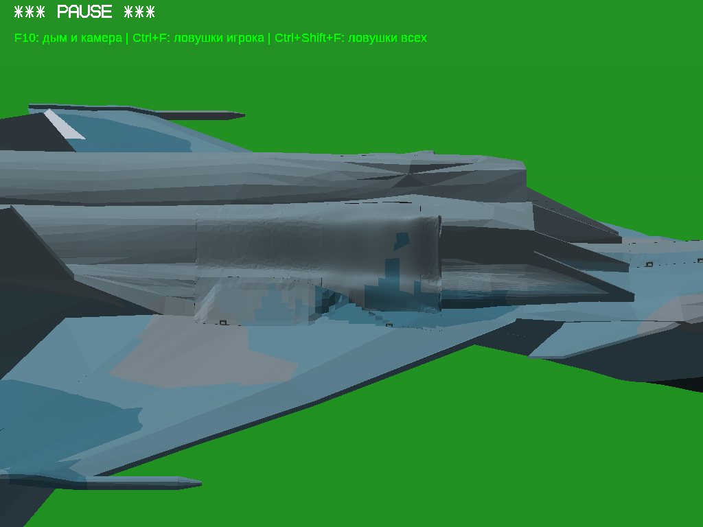

# Су-30СМ: исправление неудачной фасетизации

Изменён только **MainBayFixedSkin_Left.srf**. Все161 остальных PCK и все162 записи узлов/анимаций дословно сохранены. Створки, шасси, ниши, правая обшивка и окраска не изменены. Створка в передней части пользовательского выделения остаётся более гладкой согласно ограничению.

## Что было плохо и что сделано

Предыдущий результат04f7d3c0 оказался визуально хуже: локальная адаптивная Delaunay создала множество мелких нерегулярных плоскостей, похожих на вмятины. Успешная проверка сетки этого не опровергала. Этот вариант не использован как геометрическая база: работа продолжена от аккуратной6f8e20b2.

Новый [facet.py](../../changes/su30sm-ordered-facets/facet.py) строит общие поперечные сечения и продольные полосы с согласованными диагоналями. Уточнение добавляет целое сечение, а не одиночную точку. Исходная40-мм полоса у сопряжений закреплена; следующие35мм образуют переход к плоскостям. Внешние граничные высоты зафиксированы, проекции цветов сохранены на решётке1мкм. Нормали рассчитаны из реальных окончательных граней. Не применяются искусственные нормали или накладки.

Слишком мелкий упорядоченный пробный вариант52b73982 также отклонён после просмотра: он создавал частые узкие полосы. В окончательном варианте8f0b40ea плоскости крупнее:17 поперечных и15 продольных станций на полном параметрическом прямоугольнике; часть прямоугольника находится вне неподвижной детали. Мелкие треугольники сохранены у кромок и границ окраски, где они подразделяют общие плоскости. Уменьшение общего количества треугольников не подменяет визуальную цель.

## Собственная визуальная оценка

Фактически открыт Windows x64 OpenGL EXE под Wine. Открыты и просмотрены все шесть окончательных PNG, а также соответствующие прежние кадры. Одинаковые камеры и позы сохранены в [capture-used.sh](../../changes/su30sm-ordered-facets/capture-used.sh). Поза перевёрнута одинаково для освещения нижней поверхности; снимки не ретушировались.

**Оценка: новый вариант лучше отклонённого.** На неподвижной обшивке исчез рисунок мелких случайных вмятин; видны более крупные согласованные продольные грани, ближе по характеру к соседней мотогондоле. В близких углах и при промежуточном/выпущенном шасси новые отверстия, выступы или наложения визуально не обнаружены. Это оценка открытых игровых кадров, а не вывод только по тестам. Гладкая защищённая створка по-прежнему отличается; идентичность всего выделения окружающей модели не заявляется.

| Ракурс / положение | Аккуратная база | Отклонённый результат | Новый результат |
|---|---|---|---|
| Основной | [PNG](before/match.png) | [PNG](rejected/match.png) | [PNG](after/match.png) |
| Угол A | [PNG](before/near-a.png) | [PNG](rejected/near-a.png) | [PNG](after/near-a.png) |
| Угол B | [PNG](before/near-b.png) | [PNG](rejected/near-b.png) | [PNG](after/near-b.png) |
| Ниже | [PNG](before/lower.png) | [PNG](rejected/lower.png) | [PNG](after/lower.png) |
| Промежуточное | [PNG](before/mid.png) | [PNG](rejected/mid.png) | [PNG](after/mid.png) |
| Выпущено | [PNG](before/down.png) | [PNG](rejected/down.png) | [PNG](after/down.png) |

Отклонённый результат:

Новый результат:

## Форма и необходимые проверки

[Генератор](generator.json), [неизменные меши/узлы и топология](quality.json), [самопересечения](self.json), [контакты](contacts.json), [расстояния до исходной поверхности](shape-distance.json).

Контур и посадочные кромки сохранены. Для получения крупных плоскостей внутренние участки аппроксимированы: максимум отклонения поY в проверенных точках18,275мм. Расстояние от каждой из10820 новых внешних вершин до ближайшего исходного треугольника: максимум14,997мм, RMS1,201мм. Эти конечные измерения не доказывают максимум расстояния для каждой точки двух поверхностей. Это локальная смена гранёности, а не утверждение о побайтово неизменной форме разрешённой обшивки.

Окончательная сетка замкнута, связна, с согласованным обходом. Вырожденных треугольников, нулевых нормалей, дубликатов полигонов и самопересечений по прежнему валидатору при допуске2мкм не найдено. Отрицательный контроль глобальной сварки совпадающих вершин к намеренно разделённому граничному вееру не применяется.

Проверена только изменённая обшивка против156 соседей в201 позе:404 прежних контактных ключа до/после,0 добавленных и0 удалённых. Прежние стыковые контакты не объявляются новыми ошибками. Это дискретная проверка, не доказательство для непрерывного времени. Все записи анимаций сохранены; новый живой цикл клавишейG не выполнялся, игровые позы заданы диагностически для точного сравнения.

## Файлы, воспроизведение и сборки

Новые файлы: `changes/su30sm-ordered-facets/` (генератор, узкие проверки, упаковщик, команды и камера), `dist/su30sm-ordered-facets/ModelUpdate.zip` (проверенный единственный PCK), `reports/su30sm-ordered-facets/` (сравнения трёх вариантов и проверки), `.github/workflows/su30sm-ordered-facets-publish.yml`. Обновлён `TASK_CONTEXT.md`. Другие исходники и физика не менялись. [Команды](../../changes/su30sm-ordered-facets/README.md).

База6f8e20b21990820dcc3aa49f91e92ef4a1771047951671f61732d111256b30c6.

Итог8f0b40ea8897103c9756c1b08471d1525275adc9267030b239c0d95351257422. Повторная генерация очищенным исходным кодом побайтово совпала с игровым ресурсом.

Два полных Windows ZIP собираются из прежних отдельных x86/x64 ресурсов. EXE не пересобираются: x86 имеет настоящий PE32 Machine0x14c, x64 — PE32+ Machine0x8664. Остальные1160 прежних записей каждого ZIP сверяются побайтово. Добавлены инструкция и точная аккуратная база для отката в `runtime/rollback-ordered-facets/`. ModelSources содержит новый код и обе модели; полные неизменные исходники движка с лицензиями — в [предыдущем FullSources](https://github.com/i7885784-lang/igraYS-Flight-Simulator/releases/download/su30sm-local-skin-20261111/Su30SM_LocalSkin_FullSources.zip).

Игра проверена **x64 под Wine**, не на нативной Windows. x86 EXE поддерживается и проверяется поPE, ресурсам, SHA/CRC архива, но новый игровой запуск x86 не выполнялся. Ограничение отражается в паспортах.
