# Су-57 — локальный тест №3: кабина и ракетные держатели

26 октября 2026. Сделано в отдельной тестовой копии от Су-57 №2. По просьбе пользователя здесь **только отчёт, настоящие игровые снимки и видео**: новая игра и ZIP не публикуются. Текущая основа остаётся Су-57 №2, старые версии и отчёты сохранены.

## 1. Просвет за креслом

В прежней модели внутренняя ниша имела пол и низкую заднюю стенку. Между креслом, задней частью фонаря и корпусом не хватало сплошной верхней обшивки: с некоторых направлений можно было смотреть внутрь пустой полости.

Добавлена отдельная неподвижная задняя площадка: верх, низ, боковины и торцевые стенки. Её высота подогнана под наклон задней части фонаря. Поверхности видимы с обеих сторон и получают обычное солнечное освещение. Стекло остаётся прозрачным: вид сквозь само стекло выше обшивки не является дырой в корпусе.

Новый кадр сзади-сверху, направленный на кресло и заднюю площадку:

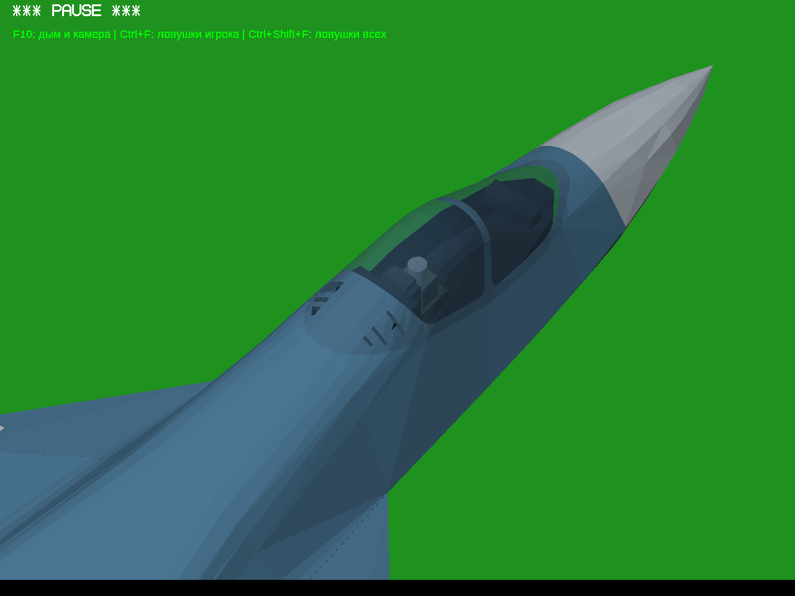

Встречный ракурс: кресло, борта и примыкание воздухозаборника:

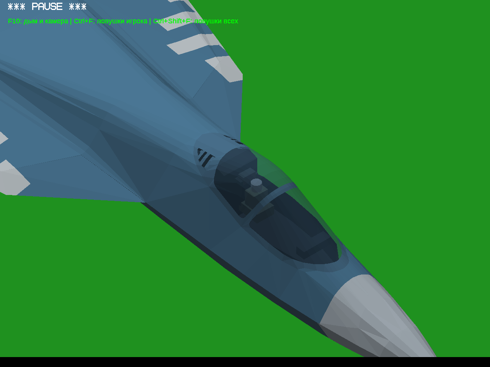

[Исходный крупный план теста №2](../su57-test-2/cockpit-detail-cockpit-close.png). Камера у старого и нового кадров различается; это не сравнение в одинаковой проекции.

## 2. Держатели и места подвески

Держатели под крылом обычно называют **пилонами**, нижняя часть под ракету — направляющей или пусковым устройством.

Добавлены четыре наружных пилона — по два под каждым крылом. Верхние грани подогнаны к реальной нижней поверхности этой игровой модели, снизу добавлены направляющие. В DAT зарегистрированы четыре точки подвески, поэтому ракеты действительно загружаются штатной системой игры, а не нарисованы частью самолёта. На снимках установлены четыре ракеты.

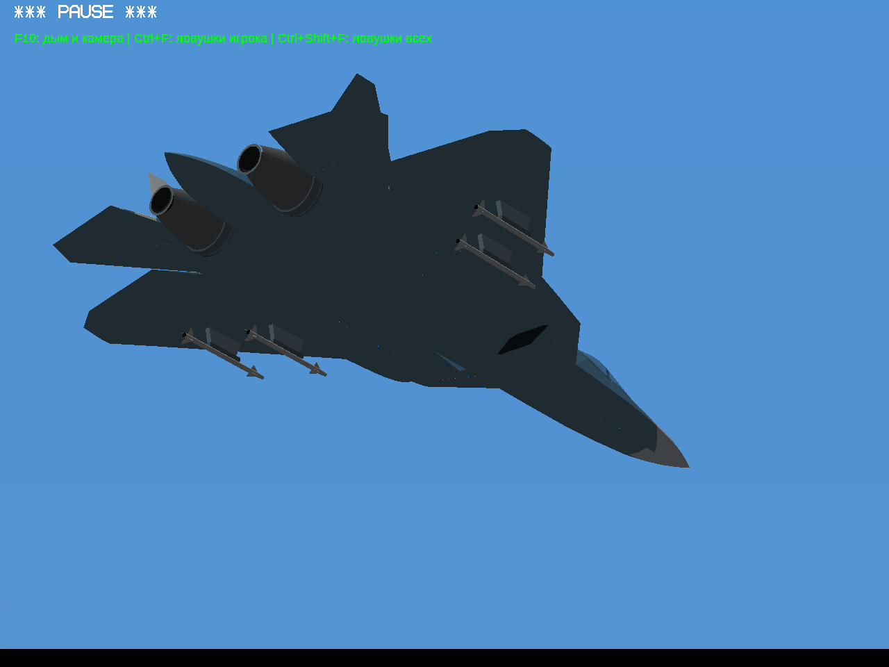

| Спереди | Сбоку |
|---|---|
| 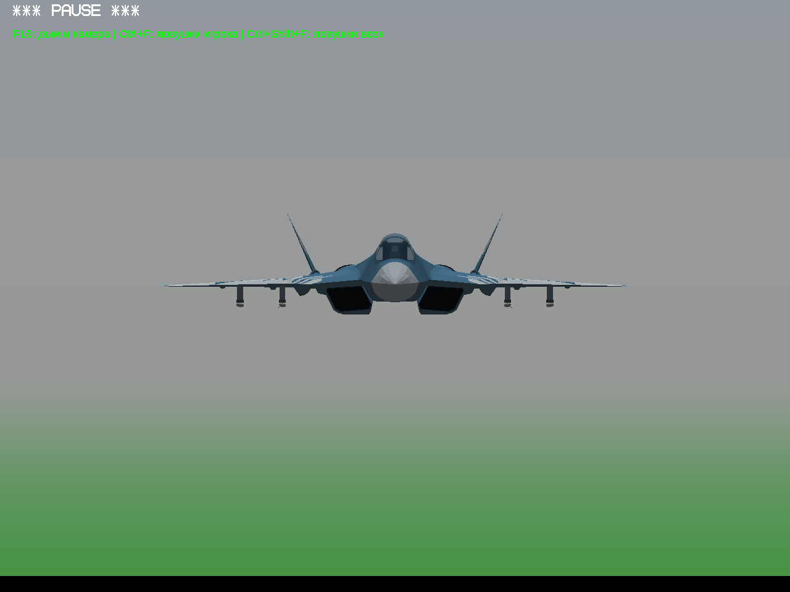 | 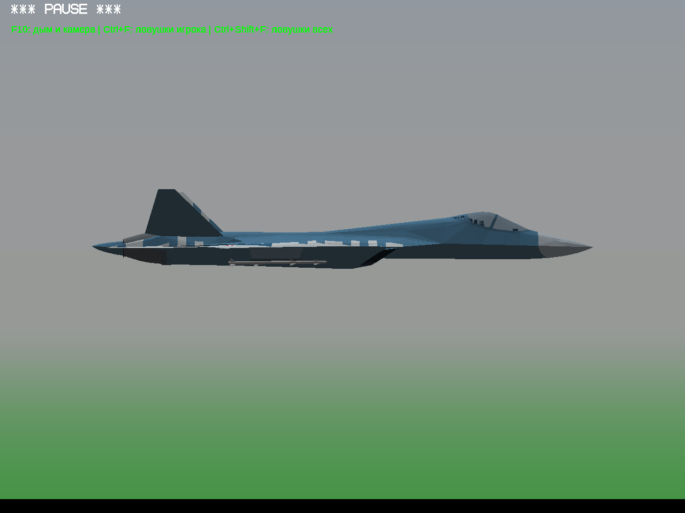 |

При первой примерке был заметен зазор между направляющей и ракетой. Точки подвески подняты ближе к направляющим. На осмотренных кадрах ракеты разнесены по отдельным местам; шасси выпускаются в отдельной проверке ниже.

### Насколько это соответствует настоящему Су-57

У Су-57 основное вооружение размещается во внутренних отсеках; наружные пилоны — отдельный вариант подвески. Эти вещи нельзя смешивать. В этом тесте **нет реализации внутренних отсеков**, их створок и механизмов выброса.

Точное число всех реальных внешних узлов, их заводские координаты и форма пускового устройства здесь **не подтверждены**. Четыре подкрыльевые станции — предварительная игровая компоновка, не заявление о полном воспроизведении реального вооружения Су-57. Доступ к Wikipedia и Airforce Technology через сеть среды вернул HTTP 403; проверку по этим источникам выполнить не удалось.

Доступен [исходный проект FlightGear](https://github.com/ShFsn/Su-57/tree/e7015f490233e78c59331f01cfbab7c5edf584b3). Его [Stores.xml](https://github.com/ShFsn/Su-57/blob/e7015f490233e78c59331f01cfbab7c5edf584b3/Models/Stores/Stores.xml) содержит собственную упрощённую схему вооружения, а README предупреждает о ранней стадии проекта. Его координаты не выдаются за заводскую документацию и не перенесены автоматически.

Ракеты на снимках — штатные **AIM9X из YSFlight**, используемые для проверки креплений. Это **не модели российских Р-74/Р-77**. Слоты допускают AIM9X и AIM120. Внешний вид соответствующих российских ракет и точную компоновку реальных держателей предстоит подтвердить отдельно по надёжным фотографиям/документации.

## 3. Дополнительно найденный дефект воздухозаборника

На нижней кромке воздухозаборника обнаружена тонкая полоса видимого фона. Причина: вход внутреннего канала был уменьшен до 98,5% контура и немного сдвинут назад, поэтому между ним и корпусом оставался зазор.

Теперь вход внутренней стенки начинается точно на найденном контуре отверстия. Изменены оба симметричных воздухозаборника. На крупном плане выше нижняя кромка замкнута; чёрная глубина канала сохранена намеренно.

## 4. Осмотр вокруг самолёта

Это восемь направлений с шагом 45°, один осмотр, без набора десятков одинаковых прогонов. Ниже — работающая игра на паузе, а не внешний рендер.

| 0° | 45° |
|---|---|
| 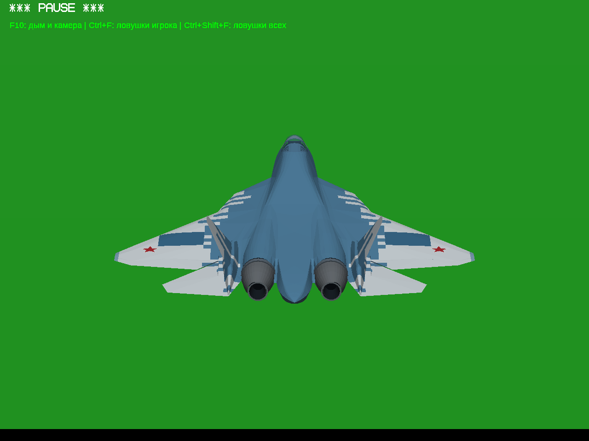 | 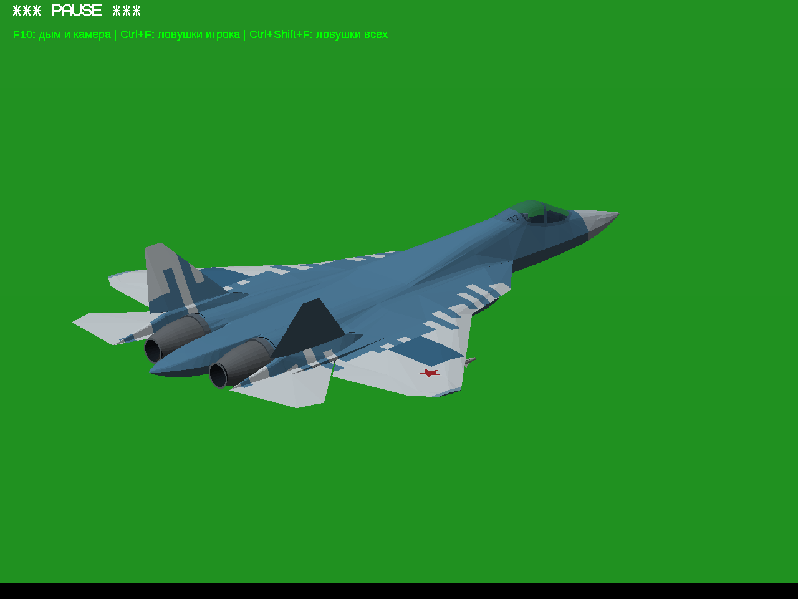 |
| 90° | 135° |
| 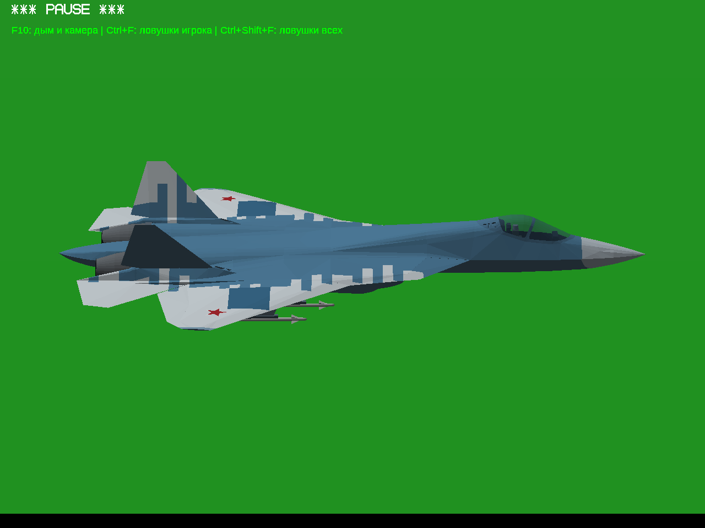 | 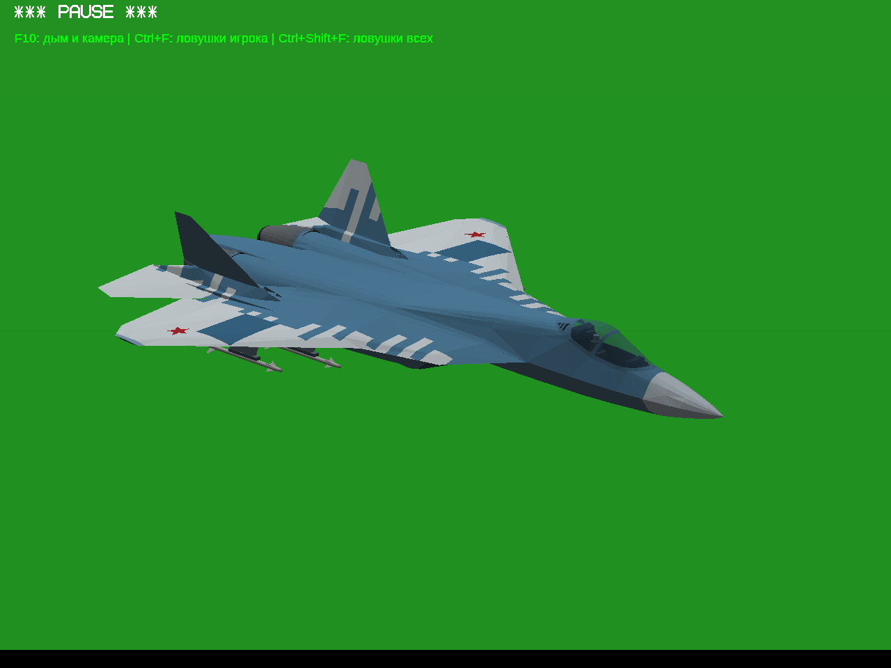 |
| 180° | 225° |
| 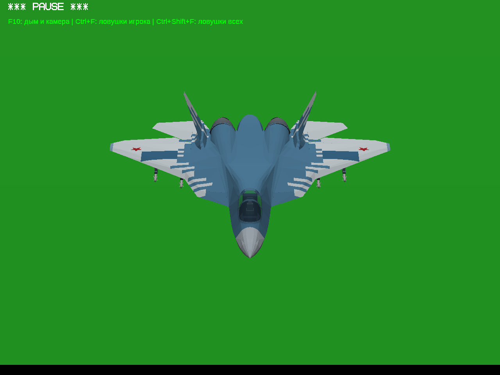 | 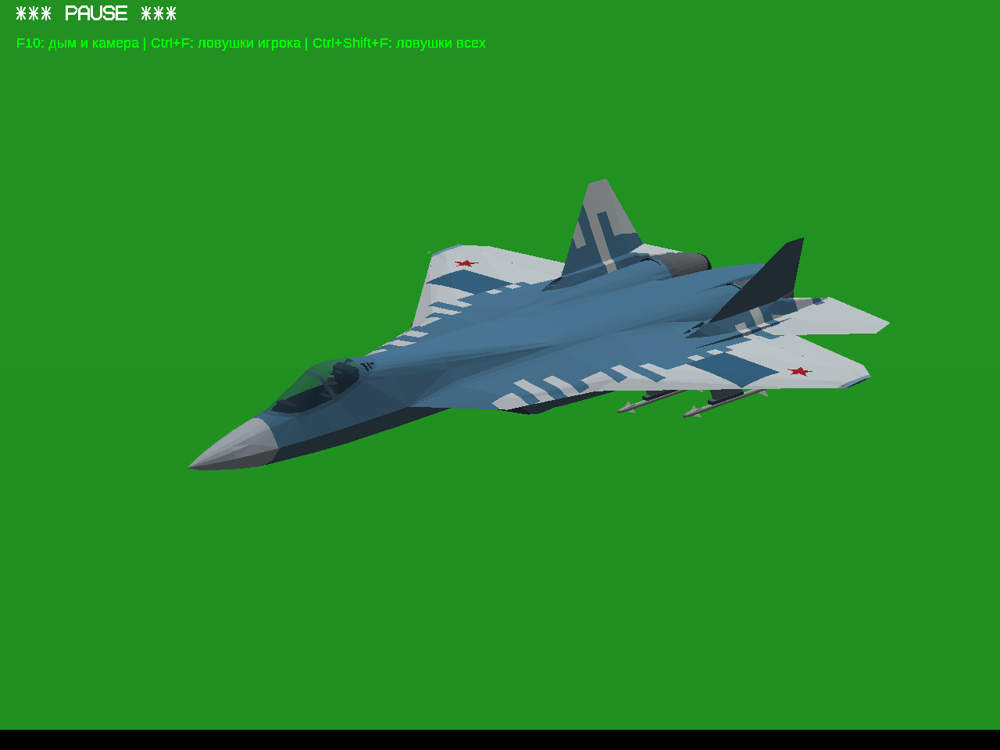 |
| 270° | 315° |
| 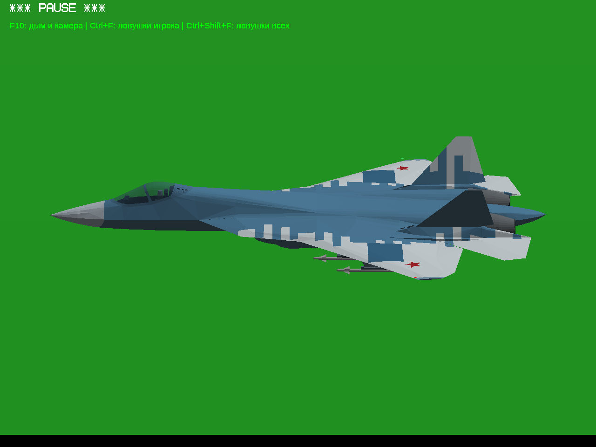 | 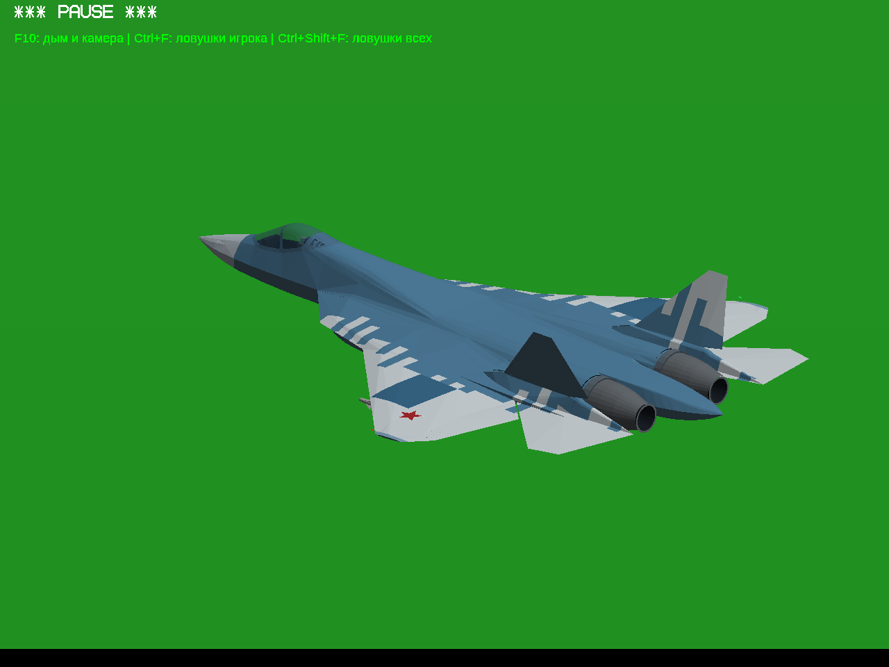 |

Вид сверху для контроля общей формы:

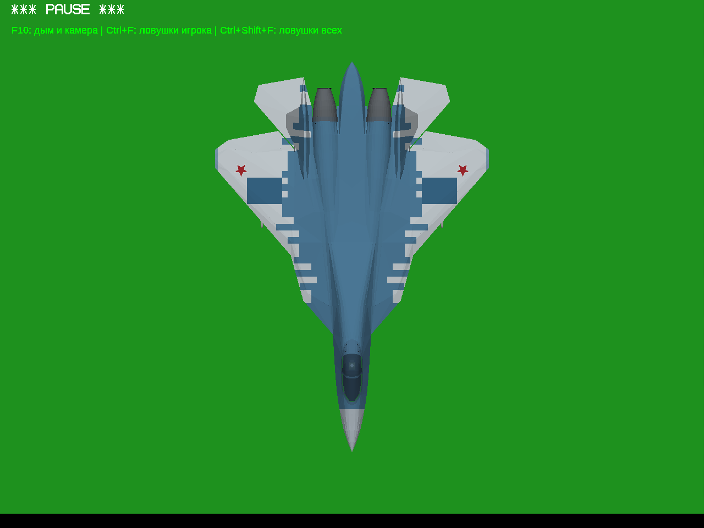

Силуэт носа, крыла, килей и двигателей заново не перестраивался. В этом тесте исправлялась обшивка кабины, стык внутренних каналов и добавлялась наружная подвеска.

## 5. Проверки и границы результата

[Видео штатного выпуска шасси в полёте](live-flight.mp4?raw=true). Это настоящая продолжающаяся симуляция под Wine, без принудительной установки положения шасси. В журнале самолёт активен, игровое время идёт, состояние шасси меняется с 0 на 1. Видео полностью декодировано FFmpeg.

- Модель загружена игрой с четырьмя ракетами. Проверены основные проекции, восемь направлений кругового осмотра, вид снизу и два крупных плана кабины.
- Проверены корректность индексов и конечность координат геометрии, уникальность узлов и обычное освещение добавленных поверхностей.
- Су-27 и МиГ-29 сохранены побайтно. Производственный EXE также прежний: C++ не менялся.
- В тестовой игре изменены только `su57.dat`, основная/дальняя DNM и SRF столкновений, пересозданный конвертером вместе с исправленными каналами. Полётные коэффициенты не перенастраивались; однако масса загруженных ракет естественно учитывается штатной физикой.

Это **не заявление «все возможные баги Су-57 устранены»**. Исправлены перечисленные дефекты; полнота реального вооружения, запуск ракет, AIM120, все положения управляющих поверхностей и полный цикл фонаря в этой итерации не проверялись. Прохождение шасси проверялось визуально одним выпуском, а не исчерпывающей проверкой столкновений во всех манёврах. Запуск выполнен отдельным Win64 диагностическим EXE под Wine; запуск Win32 на настоящей Windows 10 x86 в этой среде не подтверждён.

Локальная тестовая игра: `/workspace/ysflight-dev/su57-test-3/runtime/`. Изменённый конвертер и исходники: `/workspace/ysflight-dev/su57-test-3/model-source/`. Оригинальная геометрия ShFsn/Su-57, GPL-3.0; авторство и лицензия сохранены. ZIP не создавался и не публиковался.

[Проверки модели и контрольные суммы](model-checks.json) · [Состояния игры](capture-checks.json) · [Журнал](capture.log)
