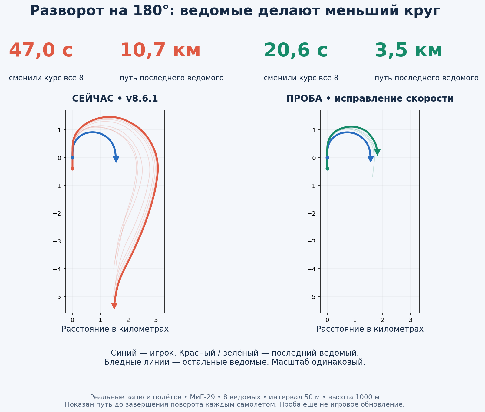
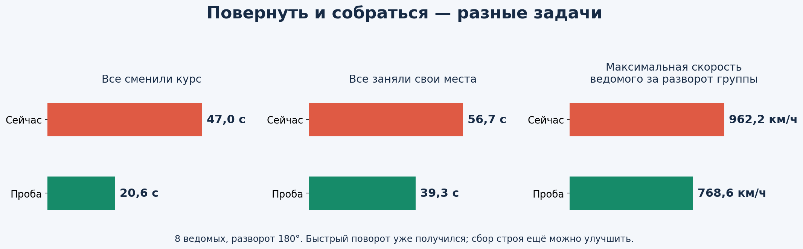
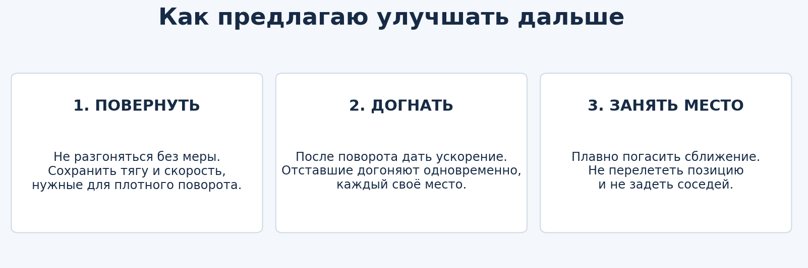

# Почему ведомые слишком широко разворачиваются

**Баг воспроизведён. Проведено 20 полётов в движке игры.** Это исследование и пробные настройки, а не готовая новая версия. Твоя v8.6.1 сохранена.

Кружок — начало поворота, треугольник — самолёт вышел на новый курс. Чем длиннее цветная линия, тем больше пути потратил ведомый. Обе половины нарисованы в одном масштабе. Это линии из записи игры.

## Главный результат

Разворот 180° с восемью ведомыми:

- Вся группа меняет курс: **47,0 → 20,6 секунды**.
- Последний ведомый проходит до выхода на новый курс: **10,7 → 3,5 км**.
- Все возвращаются в свои места: **56,7 → 39,3 секунды**. Это время от начала поворота, его не надо прибавлять к предыдущему.
- В обоих полётах все самолёты сохранились. Наименьший записанный промежуток: **30,7 → 33,5 м**.

## Что не так в нынешнем коде

Ведомый видит, что отстал, и хочет догнать движущуюся позицию. Контроллер добавляет скорость сразу, даже пока самолёт ещё поворачивает. В этом тесте ведомые разгонялись примерно до **962 км/ч**, тогда как игрок летел около **650 км/ч**. На большой скорости для того же крена нужен гораздо больший круг.

Это не просто «слишком маленький крен»: в записи ведомые и так доходят примерно до 75–77°. Первоначальная гипотеза о дополнительном ограничении крена объясняет только часть поведения, особенно небольшие довороты. Основной выигрыш в этих тестах дала работа со скоростью.

Простой пример по физике: при одинаковом крене 75° на 650 км/ч радиус установившегося горизонтального разворота около 0,9 км, на 960 км/ч — около 1,9 км. Это расчёт для объяснения, не замер радиуса каждого самолёта.

## Что попробовала

Только для категории **истребитель** ограничила лишний разгон, когда ведомому нужен заметный доворот или ведущий активно меняет курс. После выхода из поворота догонное ускорение снова доступно. Физика, характеристики самолётов, защита от земли и соседей сохранены. Самолёты не переставляются координатами.

Отдельно проверила усиление доворота и снятие дополнительного ограничения малого крена. Само по себе это помогло меньше. Сочетание обеих правок тоже не во всех случаях лучше. Поэтому на главной картинке показан более простой вариант **только с управлением скоростью**.

## Что ещё не устраивает

С одним ведомым после поворота 90° полный сбор в пробе стал **15,3 → 19,6 секунды**: это ухудшение. Курс он меняет быстрее, но точное место занимает позже. Выдавать пробу за полностью готовое исправление нельзя.

На больших группах улучшение есть, но полного результата «быстро и сразу красиво» ещё нет. Следующий шаг — отдельно настроить догон и гашение скорости возле своего места, сохранив выигрыш в повороте.

Начало поворота должно быть немедленным. Сбор идёт одновременно для всех, без ожидания впереди идущего. На малой высоте и при риске столкновения остаются ограничения безопасности.

## Как проверяла

Одинаковые сценарии: МиГ-29, океан, 1000 м, начальная скорость 180 м/с (648 км/ч), колонна с интервалом 50 м, одинаковое топливо. После 10 секунд ровного полёта ведущий получает новое направление; затем идут 120 секунд симуляции. Ведущий управляется одним и тем же автопилотом во всех вариантах. Его параметры не улучшались.

1, 4 и 8 ведомых, повороты 90° и 180°: исходник и проба со скоростью — 12 полётов. Ещё 8 полётов — отдельный доворот и сочетание правок. Всего 20 полётов. Это не проверка всех количеств, моделей, высот и строёв.

Время поворота: от начала крена ведущего более 5° до выхода на новый курс с погрешностью менее 5° на протяжении примерно 2 секунд. Время всей группы — по последнему самолёту. Сбор: все ведомые ближе 15 м к своим назначенным местам и остаются в пределах допуска до конца записи (минимум ещё 2 секунды). Это не расстояние 15 м между самолётами.

Шаг физики — 0,025 с, записи — примерно через 0,075 с. Расстояния проверены по синхронным отметкам времени, плюс состояния самолётов. Проверка выполнялась Windows x64-сборкой того же кода под Wine. Windows 10 x86 и запуск двойным щелчком в этом исследовании не проверялись: игровое обновление не собиралось.

## Полные результаты

### 1 ведомых

- Поворот 90°: смена курса **14,2 → 8,2 с**; полный сбор **15,3 → 19,6 с**.
- Поворот 180°: смена курса **35,6 → 16,9 с**; полный сбор **43,6 → 34,3 с**.

### 4 ведомых

- Поворот 90°: смена курса **19,9 → 9,4 с**; полный сбор **29,5 → 20,2 с**.
- Поворот 180°: смена курса **42,1 → 20,6 с**; полный сбор **51,3 → 37,5 с**.

### 8 ведомых

- Поворот 90°: смена курса **23,9 → 20,6 с**; полный сбор **33,5 → 26,4 с**.
- Поворот 180°: смена курса **47,0 → 20,6 с**; полный сбор **56,7 → 39,3 с**.

## Что сохранено

В архиве: отчёт с картинками, данные results.json, сценарии, исходные записи полётов и исследованные версии файла. Пробные правки не установлены в основную игру. Исходная версия управления и исходный проверочный EXE восстановлены побайтно; опубликованные игровые ZIP не менялись.

Для разработчика: SafeFormationControl в src/autopilot/fsformationsafety.cpp. wantedVelocity объединяет скорость места в строю и догонную поправку; desiredSpeed берётся из длины этого вектора. Проба меняет только ограничение desiredSpeed при активном повороте для FSAC_FIGHTER. Это ограниченное исследование; нужны дальнейшие проверки перестроений, потерь, прикрытия, малых высот и других моделей.
