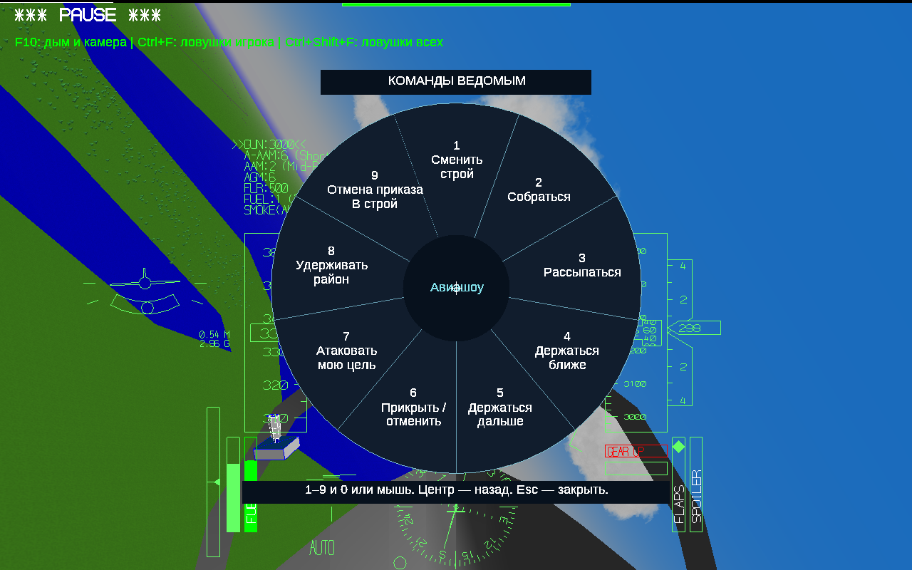

# YSFlight Airshow v8.6.1

## Высоту можно выбрать самому

Вкладка «Строй»: от 10 до 100 м, шаг 10 м. По умолчанию 40 м. Настройка сохраняется вместе с полётом. На снимке выбраны 70 м.

## Одно нажатие — все ведомые

Enter → 6. Дополнительного меню количества нет. Два самолёта стоят по сторонам центра верхней группы, без пустого воображаемого места игрока. При нечётном составе впереди один, за ним пары.

## Потери не оставляют дыр

После потери пересчитываются реальные назначенные места, а не только цифры. Обычная и верхняя группы уплотняются. Проверена потеря каждого возможного номера для составов от одного до восьми.

## Если игрок летит прямо на прикрытие

Прогноз опасного сближения смотрит вперёд до 8 секунд. При реальной угрозе вся верхняя группа уходит наружу, затем выравнивается на прежний курс. Возвращение — только по команде. Безопасный набор в другой стороне не должен включать разлёт.

## Команды остались простыми

Настоящее меню игры. Enter → 6 — прикрытие всей группой; повторно — обычный строй. Enter → 2 — «Собраться», в том числе после уступания дороги.

## Перебор высот и количеств

Полётные проверки проверяют выживание, расстояния, фактические места, срабатывание ухода и отсутствие автоматического возврата. Отдельно пройдены сбор после ухода, потери и обычный разлёт.

## Прикрытие в игре

Настоящий снимок проверки через меню: шесть ведомых и выбранная высота 70 м.

## Основа и изменения

Это новая ветка v8.6.1 от точного архива исходников v8.6. Обычный разлёт, управление, модели, дым и камеры сохранены из v8.6. Меню количества прикрывающих, поздние контроллеры и временные этажи v8.7–v8.9 не переносились. При включении прикрытия самолёты сначала выходят на выбранную высоту, затем согласованно выравниваются вдоль курса и по сторонам. Порядок этих двух горизонтальных перемещений выбирается по исходному строю. При необходимости группа предварительно немного отходит назад, чтобы освободить место над игроком. Общая высота остаётся выбранной, временных этажей нет.

Ведомые замечают прогнозируемое сближение, а не просто любое нажатие игроком набора высоты. После уступания они коротким поворотом расходятся наружу от центра группы; далее летят независимо от курса игрока. Прежняя высота является целью: небольшие отклонения во время физического манёвра допустимы. Команда «Собраться» возвращает следование; новое прикрытие включается отдельной командой.

## Как выполнены проверки

Матрица из 160 отдельных полётов: 1–8 ведомых, высоты 10–100 м с шагом 10 м, переход из обычного строя в прикрытие и отдельно уступание дороги. Испытание ухода начинается с заданного курса сближения: игрок примерно в 90 м позади переднего элемента и ниже на выбранную высоту, имеет большую продольную скорость и набирает высоту. Это подготовка исходного сценария, не перемещение ведомых во время работы ИИ. После этого самолёты движутся штатной физикой.

Дополнительные полёты: каждый вариант потери номера в колонне и прикрытии для групп 1–8, возвращение после уступания и отдельный возврат из прикрытия в колонну для всех количеств, обычный разлёт/сбор и прикрытие из остальных основных строёв. Проверяются и положения, и номера, и сохранение индивидуального цвета. Геометрия отдельно прошла 1400 случаев геометрии и выбора маршрута.

Большая матрица выполнена Win64-сборкой под Wine с шагом штатной физики 0,025 с без ожидания реального времени. Считаются настоящие управление, движение, столкновения, рельеф и записи полётов. В этой сборке есть отдельные команды подготовки проверок; в выдаваемых 32-битных EXE они выключены. Дополнительно выполнен обычный полёт через настоящее меню и проверено сохранение выбранной высоты.

## Ограничения

Если для слишком тесного исходного положения нельзя найти безопасный переход, группа удерживает места и показывает сообщение. В этом случае нужно сменить обычный строй или увеличить высоту прикрытия. Самолёты не телепортируются и не поворачивают мгновенно. Уже начавшееся столкновение или манёвр вплотную может оказаться физически неустранимым: ранняя реакция не гарантирует спасение при любых обстоятельствах. Первоначальная слишком тесная проверка показала именно такой проход; после неё расширен прогноз и исправлена сторона ухода. Отдельно обнаружено пересечение при переходе из обратного клина: исправлены назначение мест и порядок горизонтального перехода, затем повторены затронутые полёты. При непрерывном длительном наборе ведущего ранняя проверка сбора за 65 с оставила около 16 м ошибки; это не выдаётся за исправленный результат. Сбор в этой ветке проверен после выравнивания ведущего, его базовый контроллер из v8.6 не переписывался. Испытания не охватывают любые направления атаки, все модели, вертолёты, карты и интервалы. Основная матрица использует МиГ-29 и интервал 50 м.

Выдаваемые EXE проверены как PE32/i386, Windows GUI, без CMD/BAT и внешних библиотек MinGW. В среде нет настоящей Windows 10 32 бит; запуск на ней проверяет пользователь. Новая ветка не переносит отдельную балансировку ручного старта из v8.9: старт и управление остаются такими, как в выбранной v8.6.

Картинки 1, 5 и 7 — снимки игры. Остальные — поясняющие схемы, в том числе построения по журналам игры. Это игровое прикрытие, не подтверждённая профессиональная боевая схема.

## Установка

Распакуйте полный игровой ZIP в новую папку YSFlight_v8_6_1_32bit. Дважды нажмите ysflight32_gl1.exe. Альтернатива: ysflight32_gl2.exe. Старую v8.6 сохраните. Её изменённые файлы также находятся в backup_v8_6.

Выберите число ведомых, интервал и высоту прикрытия на вкладке «Строй». В полёте Enter → 6 включает прикрытие всех ведомых. После уступания дороги Enter → 2 возвращает группу. Для следующего прикрытия нажмите Enter → 6.
