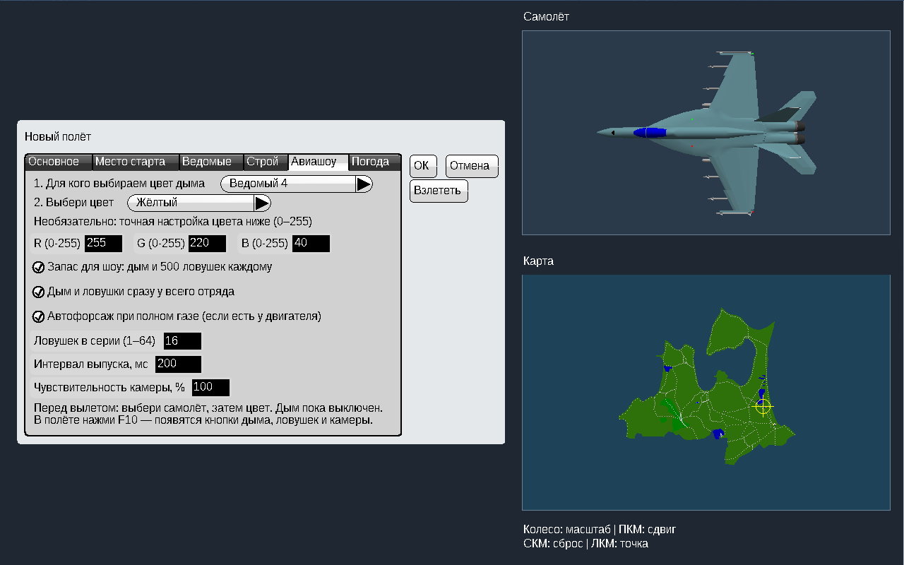
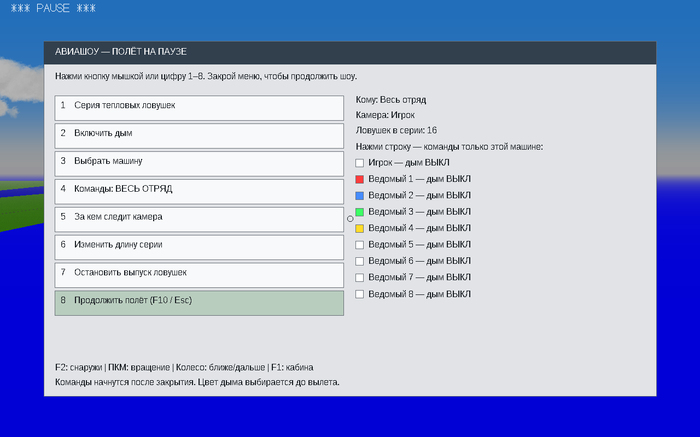
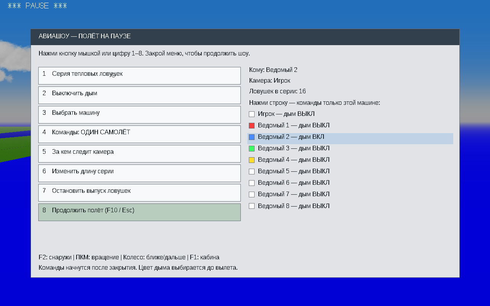
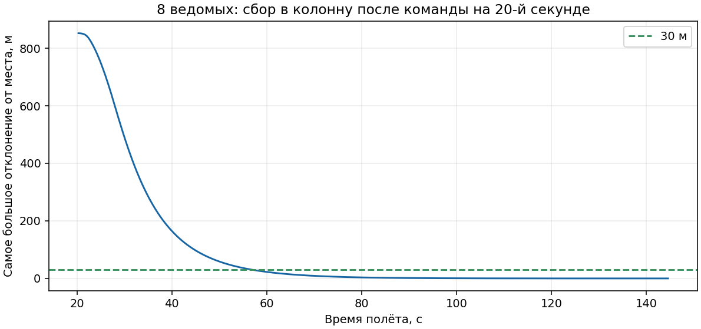
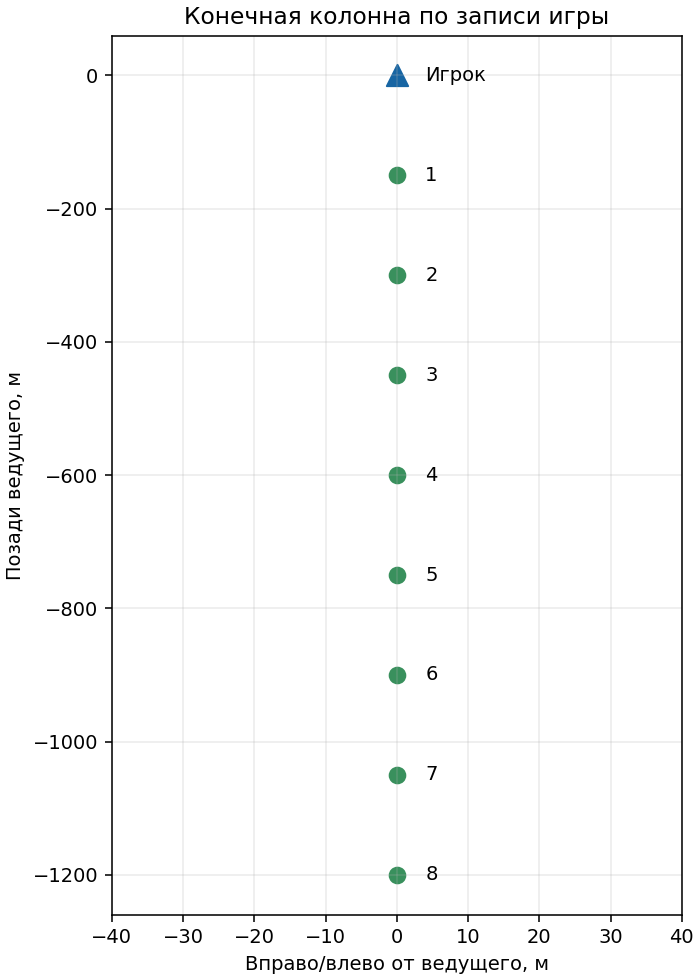

# YSFlight — Авиашоу v8.1: исправления и проверки

Дата: 19 октября 2026. Полный архив рассчитан на Windows 10 x86 (32 бит). Запуск: двойной щелчок по `ysflight32_gl1.exe` после полной распаковки ZIP. В заголовке окна теперь написано **Airshow v8.1**.

## Что исправлено

У обычных ведомых теперь один непрерывный контроллер сопровождения. Он отдельно рассчитывает курс, высоту и скорость, учитывает движение точки в строю при повороте ведущего, замедляет самолёт после обгона своей позиции и использует воздушный тормоз. На высоте безопасная скорость и допустимый крен рассчитываются по подъёмной силе и весу конкретного самолёта. Обычное сопровождение не командует переворотом или отрицательной перегрузкой, чтобы догнать место в строю.

При снижении ведомый продолжает снижаться за ведущим, но с ограничением вертикальной скорости и запасом над землёй. Если необходим вывод, приоритет получают выравнивание крена и набор безопасной высоты. Затем он возвращается к месту в строю.

Положение окна при запуске проверяется относительно подключённых мониторов. Сохранённое окно за пределами экрана возвращается на видимую область. Основной EXE запускается напрямую; отдельный CMD или помощник для этой версии не нужны.

**Уточнение к прошлому отчёту:** утверждение, что защитный флаг вообще не включался из обычного меню, было неверным. Он уже включался при обнаружении отряда. Реальная проблема оказалась в сочетании разных контроллеров: цель строя рассчитывалась по горизонтальному курсу, а старое близкое сопровождение использовало наклонённую систему координат ведущего. Также тестирование выявило конфликт управления воздушным тормозом и недостаточный учёт безопасной скорости на высоте. Эти места заменены и повторно проверены.

## Новое меню авиашоу

Перед вылетом: выбери машину, затем цвет. Точную настройку RGB можно пропустить. Шрифт интерфейса теперь не меньше 16.

В полёте нажми **F10**. Меню показывает, кому идут команды, за кем следит камера и сколько ловушек будет в серии. Можно нажимать мышкой либо клавиши **1–8**. Полёт на время выбора приостанавливается.

Нажатие строки справа выбирает одну машину. На скриншоте выбран ведомый №2: у него включён синий дым, у остальных дым выключен. **Кнопка 8 / F10 / Esc** продолжает полёт. Кнопка камеры сразу включает внешний вид.

## Результаты игровых прогонов

Все нижеуказанные игровые прогоны выполнены в Wine на **Win64-сборке тех же исходников**. Готовые EXE для пользователя собраны отдельно как PE32/i386, с оконной подсистемой, без внешних библиотек MinGW. Запуск настоящего Win32 EXE на Windows 10 x86 в этой среде не выполнялся.

| Проверка | Результат |
|---|---|
| Обычное создание через меню, 8 ведомых, общий старт | 144.6 с: все живы, все в режиме «в строю», устойчивый горизонтальный полёт |
| Перестроение в колонну, интервал 150 м | Все приблизились к своим местам ближе 30 м примерно за 37 с после команды; конечное максимальное отклонение 0.10 м |
| Разворот ведущего на 180°, 8 ведомых | 90.0 с: все живы и вернулись в строй, конечное максимальное отклонение около 14 м |
| Начальное снижение −12° с высоты 150 м, 4 ведомых | Все живы; самая низкая записанная высота 117.3 м |
| Снижение ведущего с 200 к 35 м, 4 ведомых | Все живы, снизились вслед за ведущим; минимум 35.4 м |
| Обмен местами с пересечением траекторий, 2 ведомых | 30 с: оба живы, оба вернулись к позициям |
| UH-60 и два AH-64 | 30 с: оба ведомых живы; отдельное вертолётное управление работает |
| Сохранённое окно с координатами −32000, −32000 | Окно появилось на мониторе: 1280×800; заголовок Airshow v8.1 |
| Меню авиашоу | Проверены выбор отдельной машины мышкой, дым, серия ловушек и продолжение полёта |

Сбор занимает время в зависимости от расстояния и манёвра: результат около 37 секунд относится к указанному сценарию из восьми самолётов, а не ко всем возможным самолётам, скоростям и интервалам.

Следующая картинка — диаграмма конечных координат из записи игры, а не скриншот и не придуманный строй:

## Что проверить на своём компьютере

Распакуй ZIP в новую папку, запусти `ysflight32_gl1.exe`, проверь заголовок **Airshow v8.1**. Создай полёт с одинаковыми самолётами и 4–8 ведомыми, сначала полети ровно, затем поверни и дай команду перестроения. Открой F10 и попробуй дым для одного ведомого, затем для всего отряда. Если появится ошибка, укажи самолёт, карту, высоту, число ведомых и что произошло непосредственно перед ней.

Предыдущие файлы сохранены в папках `backup_*`. Старую рабочую папку игры лучше оставить для быстрого отката. Исходники этой версии предоставляются отдельным ZIP. Данные проверок находятся в папке `data`, полные записи и сценарии — в архиве исходников.
