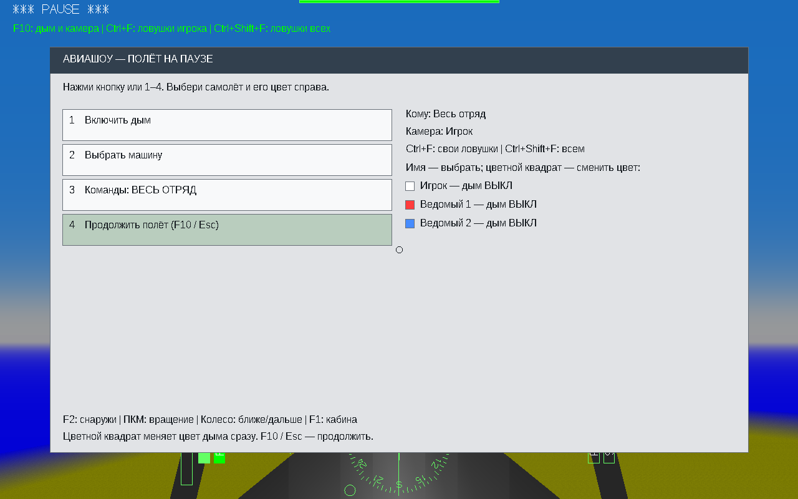
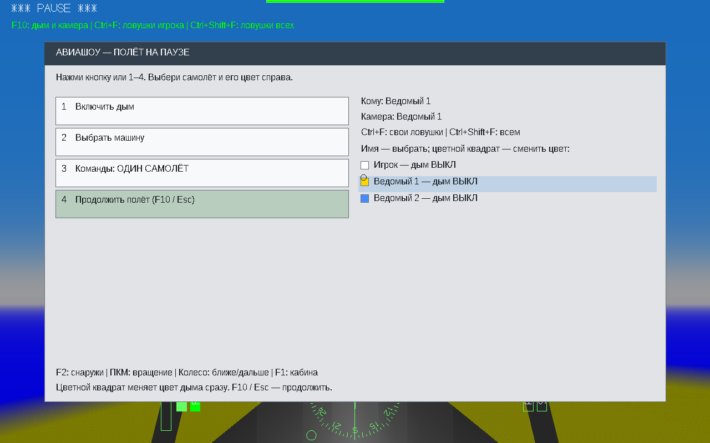
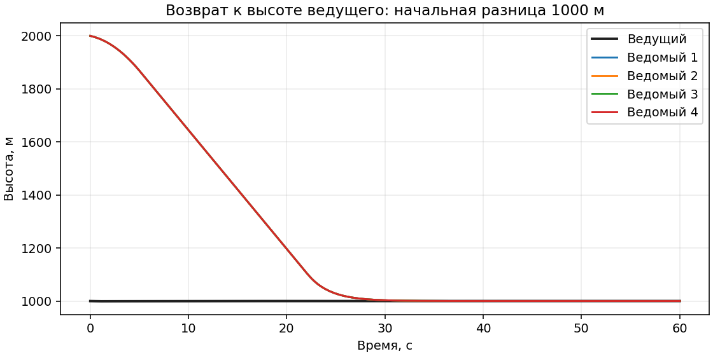
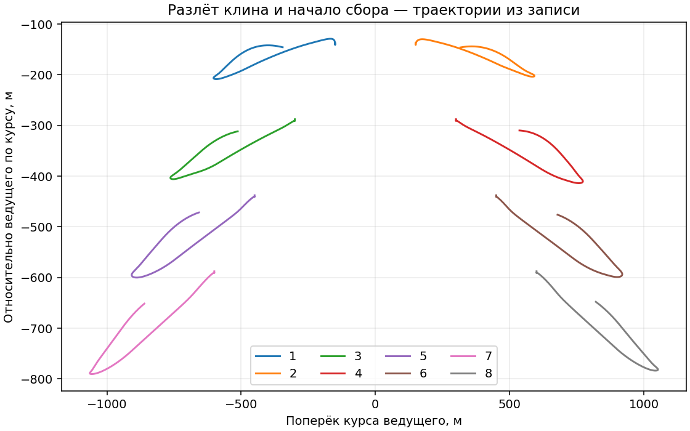

# YSFlight Airshow v8.2 — проверка

Сборка для Windows 10 x86 (32 бита). Запуск: распаковать ZIP целиком в новую папку и дважды нажать `ysflight32_gl1.exe`. Заголовок окна содержит `Airshow v8.2`. CMD и отдельный запускатель не нужны. Старую рабочую папку сохраните для отката; прежние изменённые файлы дополнительно лежат в `backup_v8_1`.

## Что изменено

- Сбор в строй: усилено сближение с назначенным местом, уменьшена задержка выравнивания высоты, увеличена допустимая скорость снижения вдали от земли. Защита от земли и недостатка скорости сохранена.
- Расхождение: прогноз сближения до 6 секунд, больший защитный интервал, боковое уклонение вместе с разнесением по высоте.
- Разлёт: в клине одновременно; в колонне с интервалом 0,8 секунды. Каждая машина через 8 секунд начинает возврат, в колонне тоже по очереди. «Собраться» возвращает раньше; другая команда строя отменяет манёвр.
- После потери самолёта номера становятся непрерывными, следующие самолёты занимают свободные места. Личный цвет дыма остаётся у своей машины.
- Повторное «Прикрытие» отменяет прикрытие. «Отмена приказа / В строй» также возвращает ведомых.
- Ctrl+F: 16 ловушек только игрока. Ctrl+Shift+F: по 16 ловушек у всех. Интервал 0,2 секунды. Клавиши не запускают обычную команду закрылков на F.
- F10 содержит управление дымом; кнопки ловушек удалены. Щелчок по имени выбирает машину и цель камеры F2. Щелчок по цветному квадрату переключает индивидуальный цвет прямо в полёте.

## Снимки настоящего интерфейса

## Проверки поведения

Проверялись обычные штатные F-18E, отдельный вертолётный полёт — UH-60 и AH-64. Это не проверка всех существующих моделей и всех возможных манёвров.

| Сценарий | Результат |
|---|---|
| Резкий разворот, 8 ведомых, 90 секунд | Все остались в полёте; конечные режимы: INPOSITION, INPOSITION, INPOSITION, INPOSITION, INPOSITION, INPOSITION, INPOSITION, INPOSITION. Минимальное расстояние между машинами группы по записи: 43.5 м. |
| Выход из начального снижения, 150 м, 4 ведомых | Все в полёте; минимальная высота 115.4 м. |
| Снижение к 35 м, 4 ведомых | Все в полёте; минимум 35.4 м. |
| Пересечение траекторий двух ведомых | Оба остались в полёте и вернулись к местам. |
| Вертолётный строй | Обе машины остались в полёте и в режиме следования. |
| Ведомые на 1000 м выше ведущего | Через 60 секунд разница высоты не больше 0.03 м. |
| Одновременный разлёт клина | Все 8 команд начали действовать одновременно; разница 0.000 с. |
| Разлёт колонны | Все 8 стартов и возвратов зарегистрированы по очереди; интервалы 0,7–0,9 с. |
| Прикрытие и отмена | Сначала у всех задача прикрытия, затем у всех обычное следование. |
| Потеря ведомого №4 | Было 8, стало 7; номера непрерывны, прежние 5–8 заняли места 4–7. |
| Замедление ведущего | Ведущий 150.00 м/с; скорости ведомых 150.00, 150.00, 150.00, 150.00, 150.00, 150.00, 150.00 м/с. |
| Ctrl+F | Запасы: игрок 500→484; ведомые остались с 500. |
| Ctrl+Shift+F | Следующая серия: игрок 484→468; оба ведомых 500→484. |
| Цвет в полёте | Щелчок сменил RGB на 255, 215, 0; изменение подтверждено состоянием игры. |

Исходные записи `.yfs`, журналы и сценарии лежат в архиве исходников. Данные проверок: `data/`.

## Что проверить на вашем компьютере

Облачные полёты выполнены в 64-битной сборке того же C++ кода под Wine. В игровой ZIP включены 32-битные EXE OpenGL 1 и OpenGL 2; формат PE32/i386, оконный режим Windows GUI и зависимости проверяются отдельно при упаковке. Эта среда не позволяет подтвердить настоящий запуск на Windows 10 x86.

1. Проверьте двойной щелчок по EXE и надпись v8.2 в заголовке.
2. Создайте группу из 4–8 одинаковых самолётов. На безопасной высоте попробуйте колонну и «Разлёт», затем клин и «Разлёт».
3. Попробуйте снижение, ровный полёт и торможение; после манёвра дайте группе время физически добраться до мест.
4. Попробуйте Ctrl+F, Ctrl+Shift+F и смену цветов в F10.
5. Дайте «Прикрытие», затем отмените его повторной командой или «Отмена приказа / В строй».

У разных самолётов различаются скорость, перегрузка и радиус разворота. Самолёт не может безопасно держать скорость зависшего вертолёта. Абсолютное отсутствие столкновений при любых начальных условиях и любом пилотировании не обещается.
