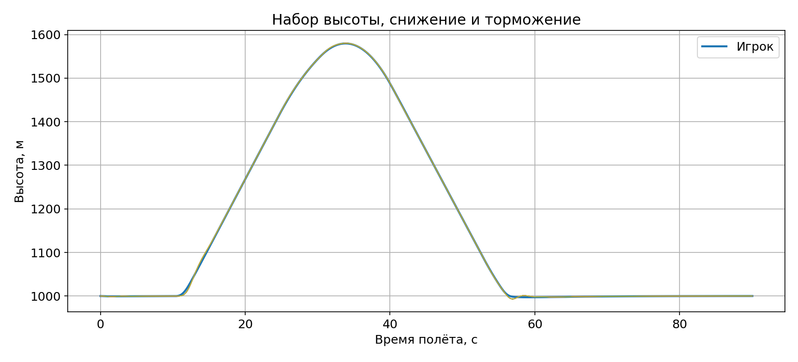
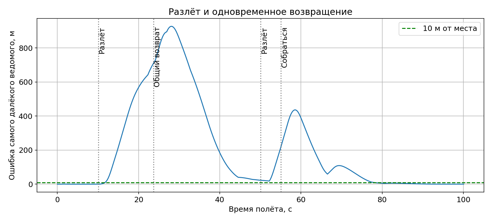
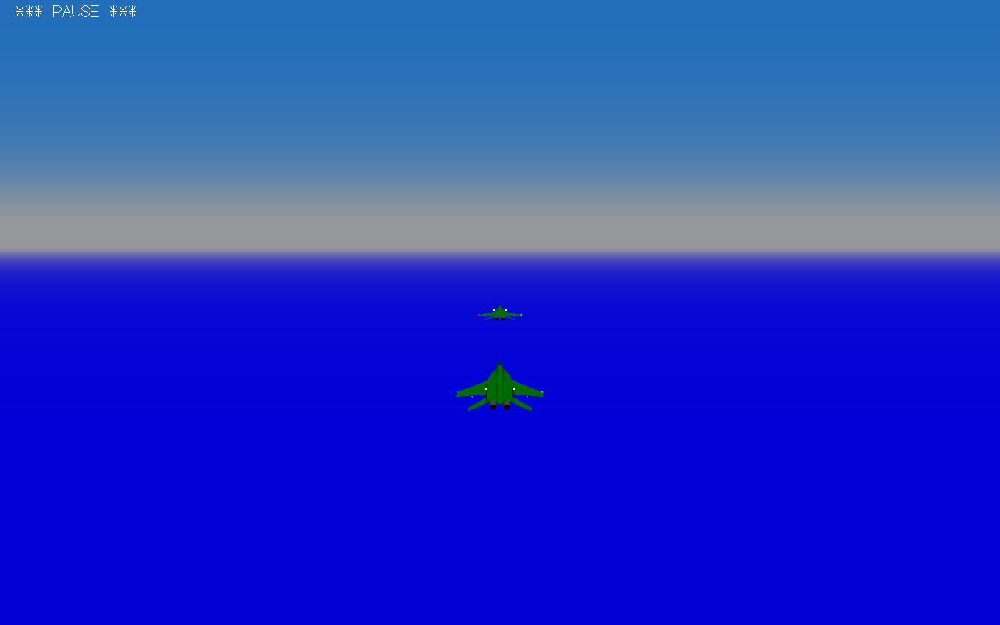
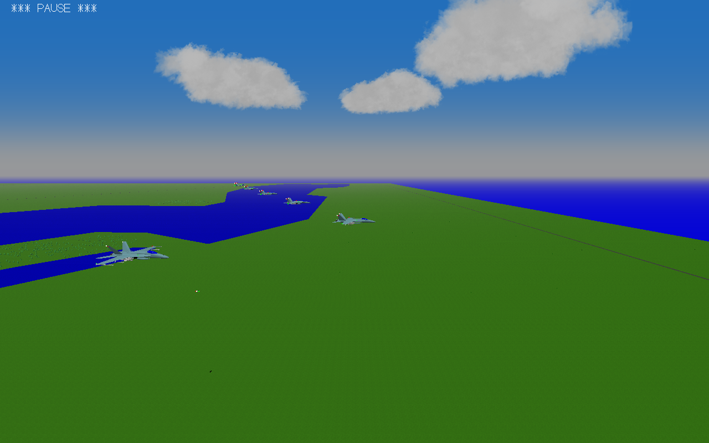

# v8.3 — ведомые: сразу следовать, вместе собираться

**Ошибка воспроизведена:** в v8.2 восемь МиГ‑29 при дистанции 50 м сами уходили выше игрока. При 150 м тот же опыт её не воспроизвёл. Причина: порог уклонения был больше интервала строя, а уклонение назначало постоянные ступени высоты по номеру ведомого. Это подтверждённый сценарий; точные начальные настройки твоего видео неизвестны.

**Исправлено:** близкий параллельный строй не вызывает уклонение. Опасность оценивается по сближению и размерам самолётов. Разведение по высоте временное. После 5-й секунды прямого полёта максимальная разница высот — **0.07 м**.

Гибрид: реагировать сразу, безопасно перехватывать своё место. Каждый ведомый следует за игроком, не ждёт переднего. Используются ускорение и воздушный тормоз; перед слиянием с колонной — боковой заход. Усиленное гашение колебаний включается на прямом участке и ослабляется в повороте, чтобы не задерживать отклик.

В этом развороте задержка начала реакции всех ведомых — не более **0.91 с**. Весь отряд устойчиво оказался ближе 10 м от своих мест через **17.3 с после выравнивания игрока**. Это результат конкретного опыта, не гарантия для любого манёвра.

При наборе высоты задержка — не более **0.41 с**. Ведомые продолжают снижаться за игроком, ограничивая снижение около земли. Скорость следует за игроком; защита от сваливания сохраняется.

В колонне разлёт остаётся по очереди через 0,8 с. Обратный сбор начинается **у всех одновременно**. «Собраться» отменяет даже ещё не начавшийся выход. Длительная проверка проверяет не только первое попадание в строй, но и его удержание.

## Запуск и повтор

Автоматически пройдены «Новый полёт» и «Повторить»: в обоих стартах восемь ведомых. При мыши/клавиатуре нет блокирующего ожидания центрирования джойстика; физический джойстик сохраняет прежнюю проверку.

**Новые 50 м по умолчанию применяются к «Новому полёту». «Повторить» сохраняет прежние настройки, в том числе старую дистанцию.** Для больших самолётов интервал дополнительно ограничен размерами.

При «Собраться» после краткого торможения обычный самолёт больше не переключается навсегда на отдельный круговой автопилот. Вертолётная защита сохранена.

## Проверки

| Реальный автоматический полёт | Результат | Минимум между центрами |
|---|---|---|
| МиГ‑29: 8 ведомых, 50 м | Пройдено | 50.0 м |
| МиГ‑29: разворот | Пройдено | 40.7 м |
| Набор / снижение / торможение | Пройдено | 36.9 м |
| Два разлёта и возврат | Пройдено | 33.5 м |
| F‑18E: выход у земли | Пройдено | 150.1 м |
| Вертолётный строй | Пройдено | 122.4 м |
| Су‑27: 8 ведомых, 50 м | Пройдено | 50.0 м |
| Су‑27: разворот | Пройдено | 42.0 м |
| Сбор после резкого торможения | Пройдено | 37.7 м |
| Новый полёт → Повторить | Пройдено | — |

Контроль читает записи настоящей игры: выживание, дистанции с учётом радиусов моделей, ошибки мест, высоты, скорости и время приказов. Скрипты диагностических полётов и записи находятся в ZIP исходников. Проверки повторяемые и не используют языковую модель во время полёта.

Полёты выполнены в Win64-сборке тех же исходников под Wine. Выдаваемые EXE — **Windows GUI, PE32/i386**, без CMD, со статическими библиотеками компилятора; код после упаковки сравнен со сборкой. **Запуск новой версии на настоящей Windows 10 32 бит проверяет пользователь.** Здесь нет такого окружения. Все модели, карты, горы и произвольные экстремальные манёвры не охвачены.

## Установка

Распаковать полный ZIP в **новую папку**, открыть `YSFlight_v8_3_32bit` и дважды нажать `ysflight32_gl1.exe`. В заголовке — **Airshow v8.3**. Альтернатива — `ysflight32_gl2.exe`. Старую рабочую папку сохранить. Предыдущие изменённые файлы включены в `backup_v8_2`.

Первая проверка: новый полёт, МиГ‑29 или Су‑27, 8 ведомых, колонна, 50 м; прямой полёт, поворот, набор/снижение, затем «Разлёт» → «Собраться». Сравнить высоту, скорость и восстановление строя. Управление дымом и ловушками сохранено.
