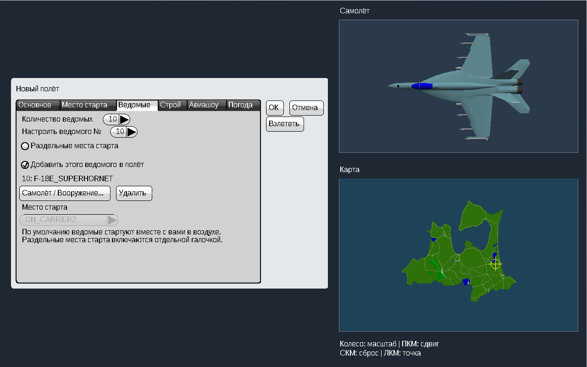
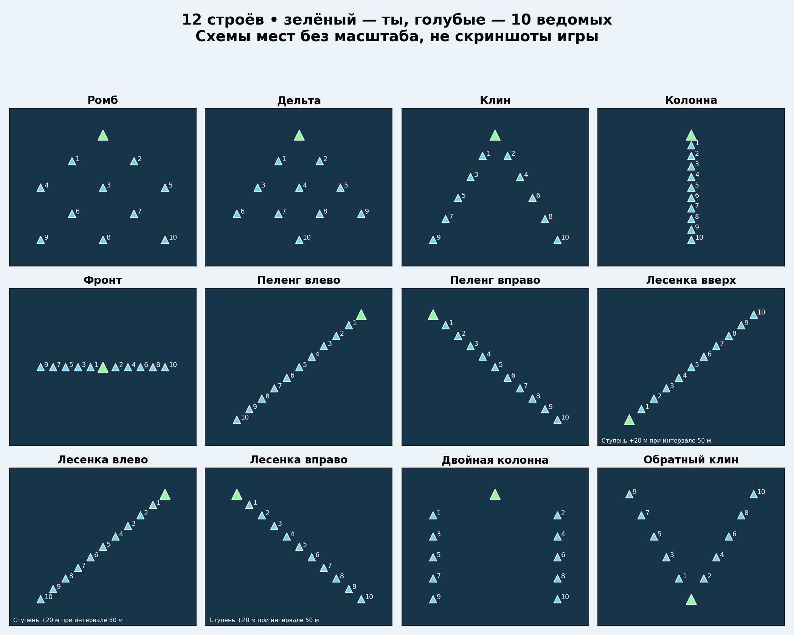
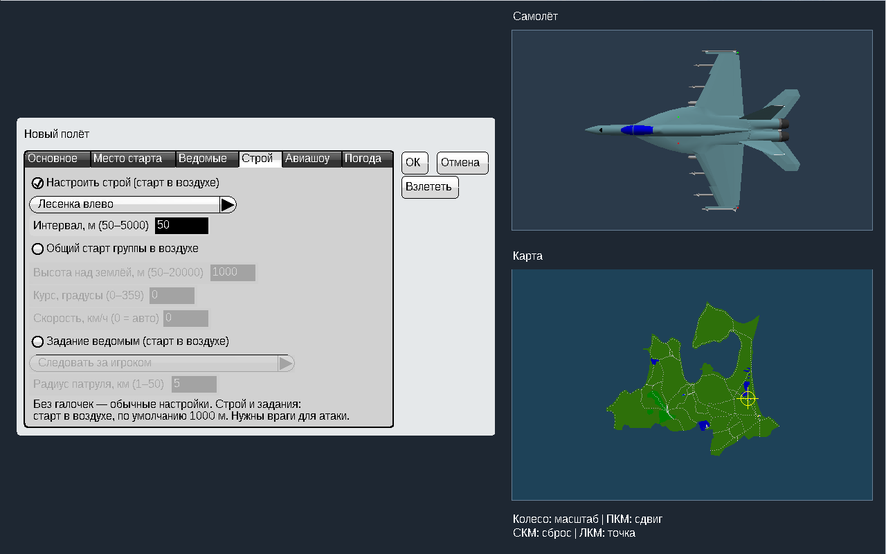
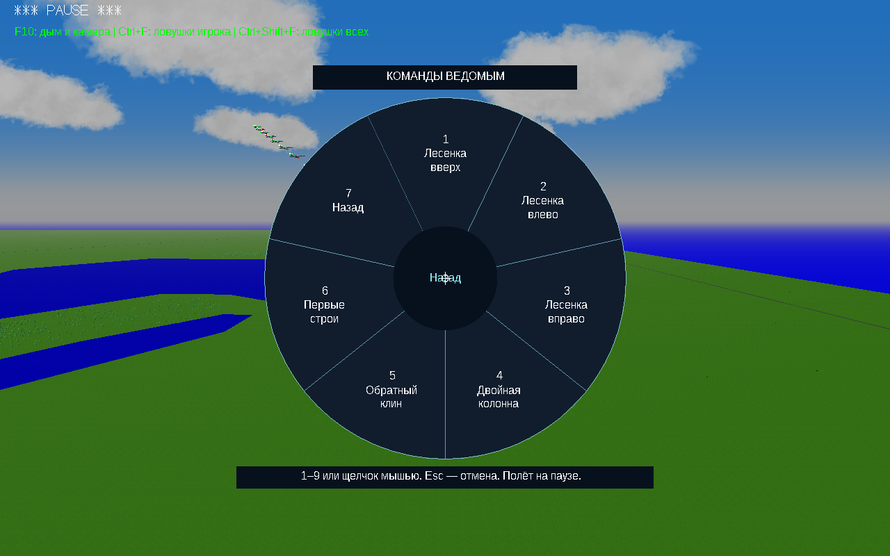
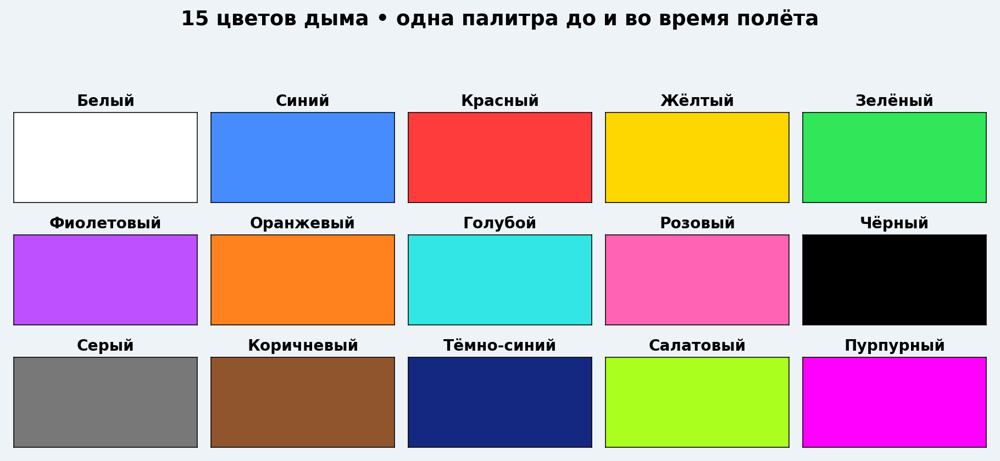
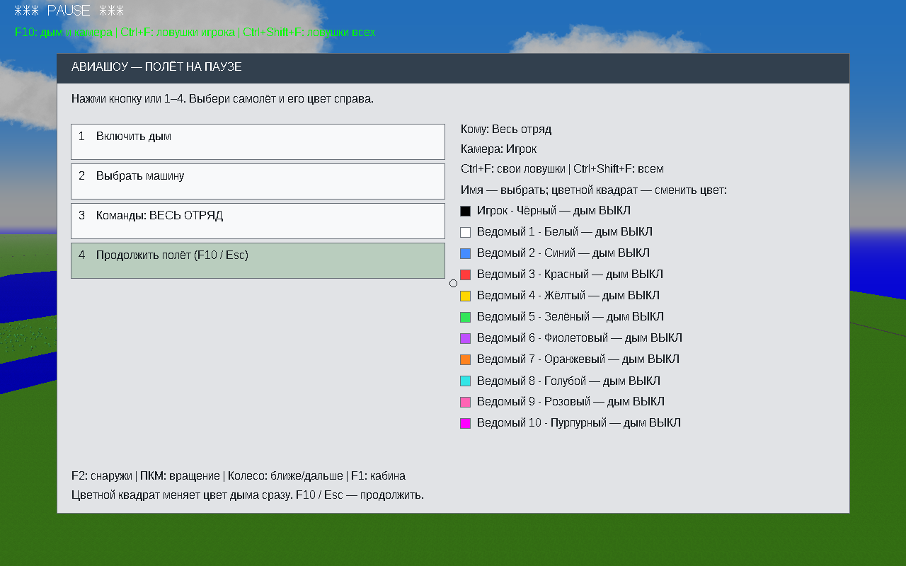
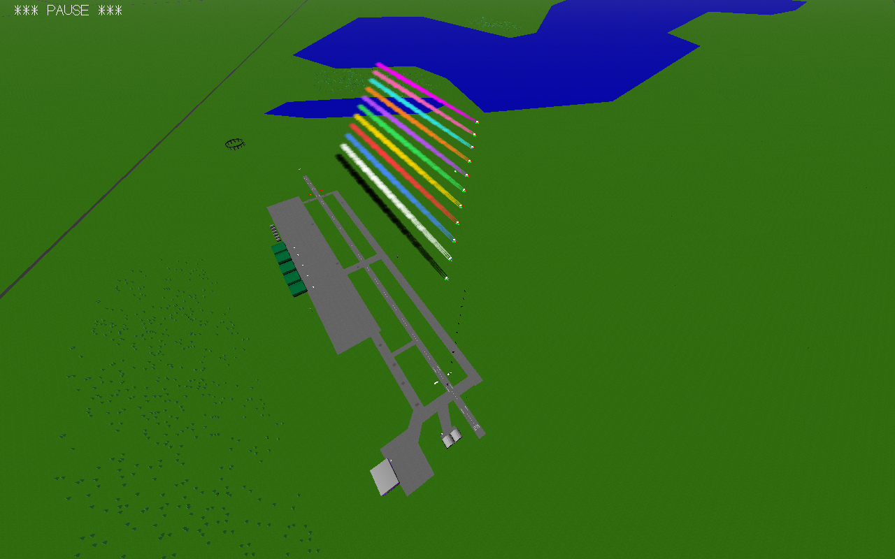

# Airshow v8.4 — больше самолётов, строёв и цветов

## 10 ведомых + ты = 11 самолётов

Создай новый полёт → вкладка «Ведомые» → количество **10**. Девятый и десятый настраиваются отдельно. Старый сохранённый полёт сам не добавит новые машины.

## 12 строёв

Новые: **лесенка вверх, лесенка влево, лесенка вправо, двойная колонна и обратный клин**. В лесенках следующий самолёт выше предыдущего на 20 м при интервале 50 м. Это выбранное построение, а не прежняя ошибка самовольного набора высоты. При выборе обычного строя вертикальных ступеней нет.

Перед стартом: «Строй» → включить настройку → выбрать вариант. В воздухе: **Enter → Строй → Новые строи**. Кнопка возвращения ведёт обратно. Первые семь вариантов сохранены; у ромба и дельты добавлены отдельные места для девятого и десятого ведомого.

## 15 цветов, включая чёрный

Перед полётом: «Авиашоу» → выбрать самолёт → выбрать цвет. В воздухе: **F10 → нажимать цветной квадрат рядом с нужной машиной**. Название цвета видно в строке. Переключение перебирает 15 цветов и возвращается к первому. Произвольный RGB сохранён.

## Что проверено

- У всех 12 схем по десять отдельных мест; минимальный интервал геометрии — не меньше 50 м при заданных 50 м.
- Семь реальных полётов: ромб, дельта и все пять новых строёв с десятью ведомыми.
- Разворот десяти ведомых и последовательная смена новых строёв в полёте: выживание, расстояния и возвращение к назначенным местам.
- Создание полёта и «Повторить»: десять ведомых в обоих запусках, сохранены индивидуальные цвета всех одиннадцати самолётов и высота лесенки.
- Все пятнадцать цветов переключены мышью в настоящем меню, проверены цвета нарисованных квадратов.
- Файлы моделей, карт и прежних ресурсов сохранены. Предыдущие изменённые файлы — в `backup_v8_3`.

Полёты выполнены в Win64-сборке того же кода под Wine. Игровые EXE — **PE32/i386, Windows GUI**, без CMD. Запуск новой версии на настоящей Windows 10 32 бит проверяет пользователь. Все самолёты и любые экстремальные манёвры этими испытаниями не охвачены.

## Установка

Распаковать весь ZIP в **новую папку**, открыть `YSFlight_v8_4_32bit`, дважды нажать **ysflight32_gl1.exe**. В заголовке — **Airshow v8.4**. Альтернатива — `ysflight32_gl2.exe`. Рабочую v8.3 сохранить.

Клавиши остались прежними: **Enter** — приказы, **F10** — дым, **Ctrl+F** — ловушки игрока, **Ctrl+Shift+F** — ловушки всей группы, **F2** — внешняя камера, **ПКМ / колесо** — вращение / расстояние, **F1** — кабина.
