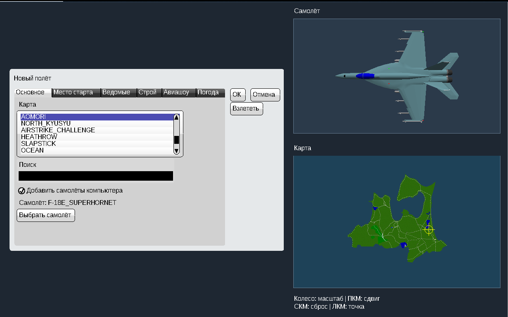
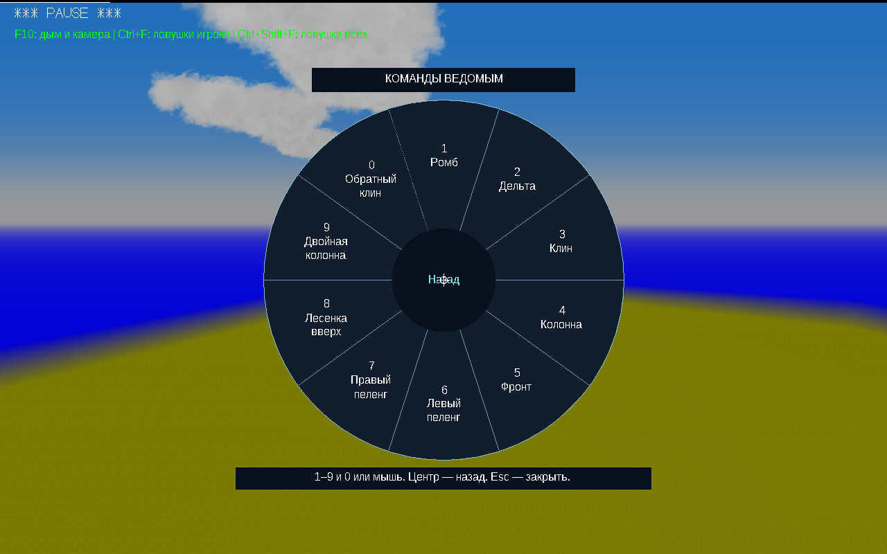
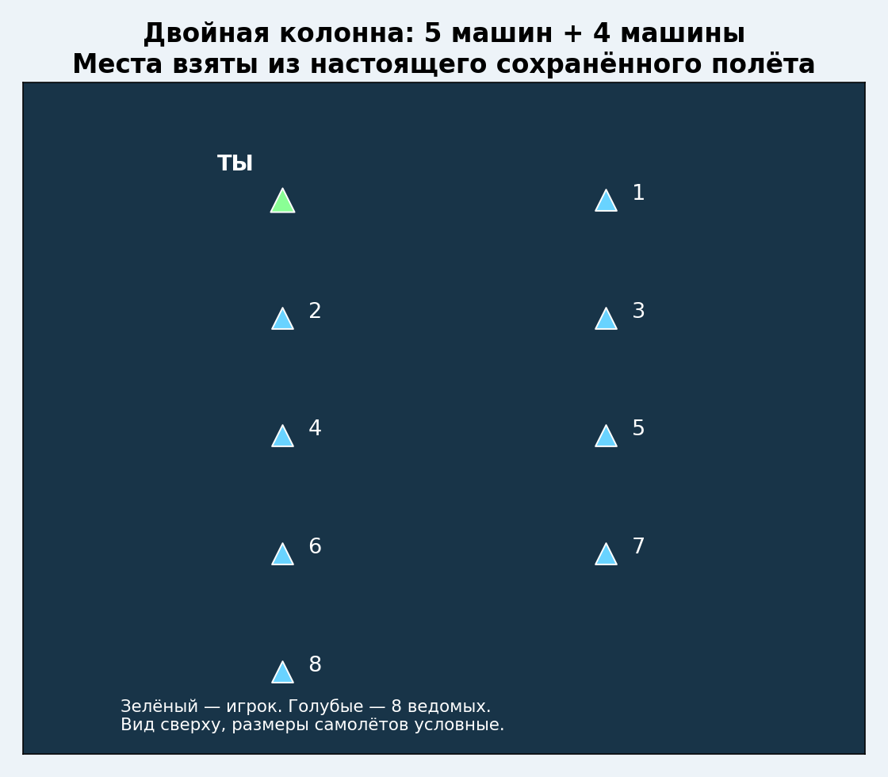
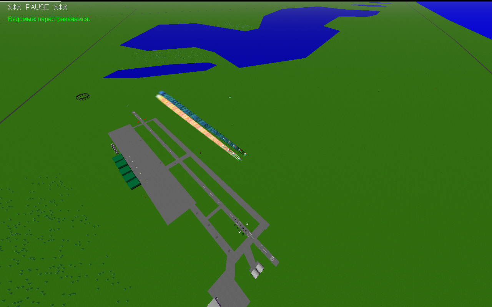
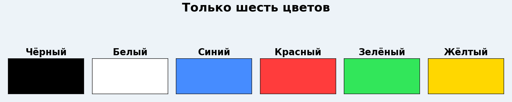
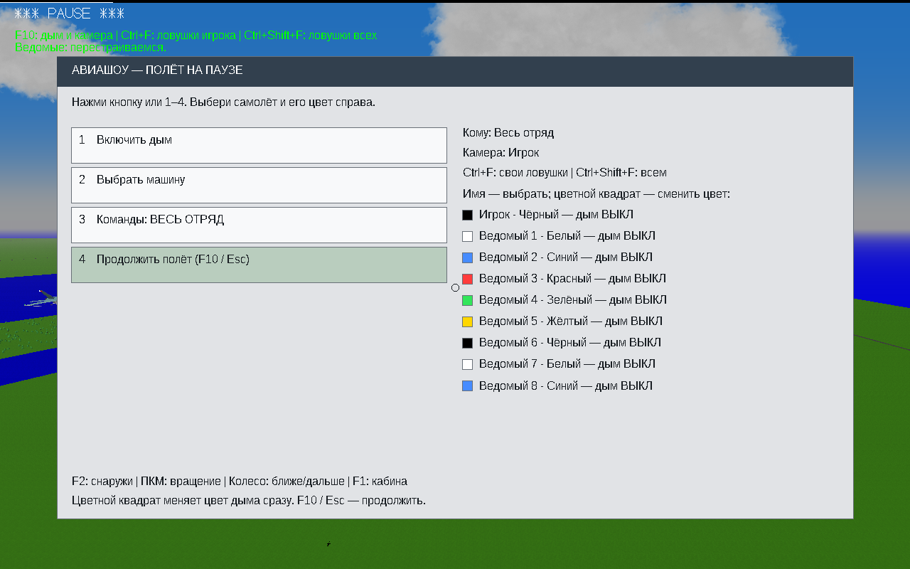
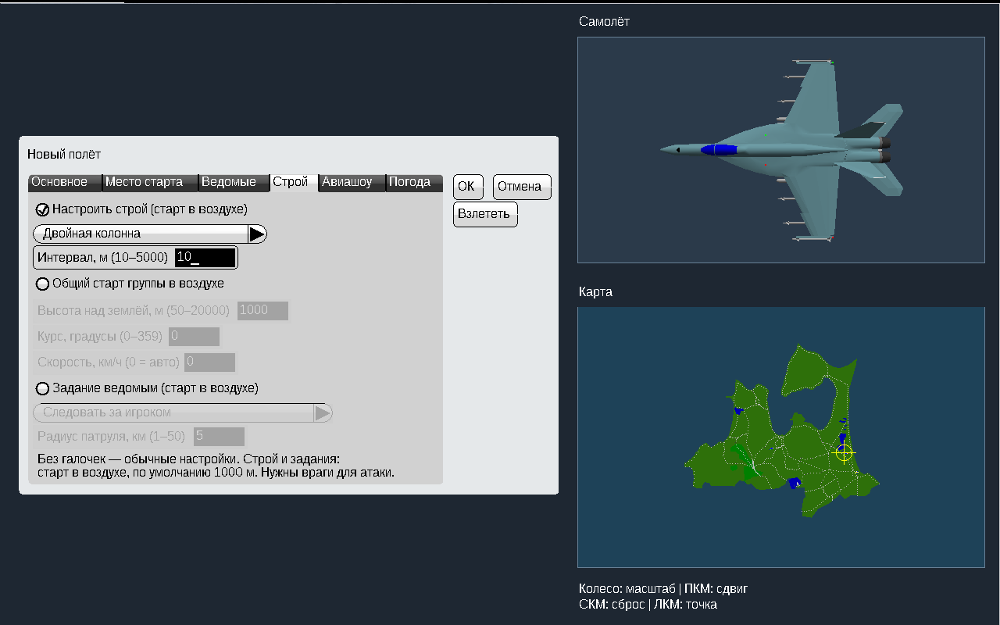

# Airshow v8.5 — пауза, продолжение и упрощённые настройки

## Продолжить с того же места

**Два Esc → «Продолжить»** сохраняют текущий полёт в памяти: положение, скорость, ведомых и их приказы. Повторной подготовки самолётов при продолжении нет. «Повторить полёт» отдельно начинает полёт сначала.

При **сворачивании и переключении в другое окно** полёт переходит на паузу. После возвращения нажми «Продолжить». Таймера бездействия нет: можно спокойно лететь прямо без нажатий. Само окно запускается развёрнутым, с обычной рамкой и кнопками Windows.

Проверки подтвердили совпадение времени остановки и продолжения. Отдельно проверено: открыть создание нового полёта, отменить его и продолжить старый — без сброса.

## 8 ведомых и все строи на одной странице

Лесенки вправо и влево убраны из выбора. Остались **10 строёв**: ромб, дельта, клин, колонна, фронт, левый и правый пеленг, лесенка вверх, двойная колонна и обратный клин. Выбор — **1–9, 0 или мышь**. Центр круга — назад.

Игрок теперь в начале одной из двух параллельных колонн. Всего девять машин: пять в одной колонне, четыре в другой. Схема выше построена по сохранённым в игре местам, а не по отдельной придуманной раскладке.

## Шесть цветов

**Чёрный, белый, синий, красный, зелёный, жёлтый.** Остальные варианты и произвольный RGB убраны из настройки авиашоу. При загрузке старого нестандартного цвета выбирается ближайший из этих шести.

Цвет меняется в F10 нажатием квадрата рядом с машиной. Все шесть цветов проверены настоящими щелчками мыши.

## Интервал от 10 м, по умолчанию 50 м

Поле принимает **10–5000 м**, стандартное значение — **50 м**. При старте действует защита по размерам самолётов и запасу на торможение. Поэтому 10 в поле не означает 10 м между центрами больших самолётов.

В проверке F‑18E при введённых 10 м безопасный стартовый интервал составил **35.2 м**. Проверка резкого торможения выявила слишком близкий проход; добавлено упреждение скорости ведущего для плотных строёв и увеличен защитный запас. Окончательная проверка пройдена: минимум между центрами **26.5 м**, все восемь ведомых остались в воздухе. Обычный режим 50 м не использует это дополнительное упреждение.

## Разлёт и потеря игрока

Раньше разлёт удерживал точки относительно ведущего и включал автоматический возврат. Теперь самолёты получают **разные курсы к далёким точкам в пространстве** и сами обратно не собираются. В колонне выход остаётся по очереди; «Собраться» отзывает всех одновременно.

В испытании через 30 секунд после команды расстояние до игрока составляло примерно **3.3–3.8 км**. До отдельной команды сбора все оставались на самостоятельных маршрутах. После команды вернулись в строй без потерь.

После смертельного повреждения игрока ведомые прекращают следование уже за падающим самолётом, а не только после его удара о землю. В проверке все восемь перешли на самостоятельный полёт и не нырнули за обломками.

## Новый полёт и управление

«Создать новый полёт» сразу открывает настройку, без «Удалить текущий полёт?». История прежнего полёта сохраняется. Отмена диалога оставляет возможность продолжить прежний полёт.

По умолчанию управление на **стрелках**. При первом обновлении применяется клавиатурный вариант; затем выбор мыши или клавиатуры сохраняется через настройки. Остальные назначения не сбрасываются.

## Что проверено и что проверить у себя

Шесть сценариев: продолжение после Esc; переключение окна и сворачивание; разлёт и отзыв; потеря игрока; интерфейс, цвета и плотная двойная колонна; отмена создания нового полёта. Дополнительно проверены ограничения 8/6/10 в общей геометрии. Проверка продолжения также выполнена с отсутствующим файлом назначений управления.

Полёты выполнялись в Win64-сборке тех же исходников под Wine. Выдаваемые EXE проверяются как **PE32/i386, Windows GUI**. Запуск новой версии на настоящей Windows 10 32 бит проверяет пользователь. Все модели, карты и любые экстремальные манёвры не охвачены.

Распаковать полный ZIP в новую папку `YSFlight_v8_5_32bit`, дважды нажать **ysflight32_gl1.exe**. Альтернатива — `ysflight32_gl2.exe`. Предыдущие изменённые файлы — в `backup_v8_4`. Рабочую v8.4 сохранить.
