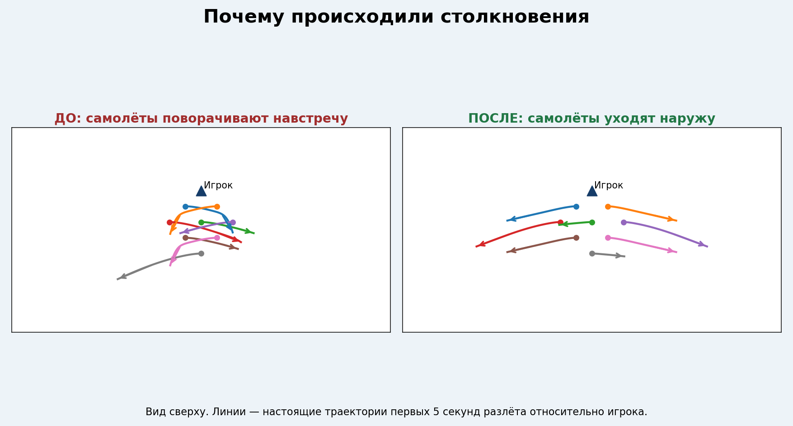
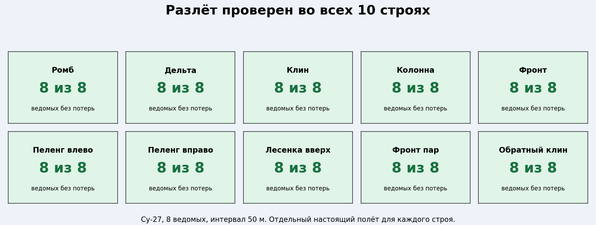
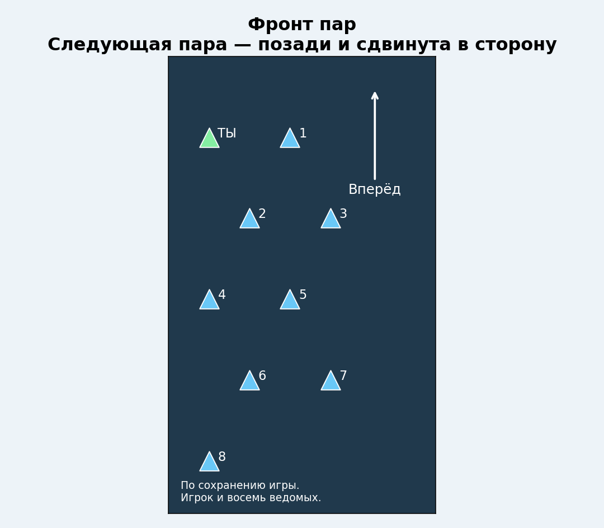
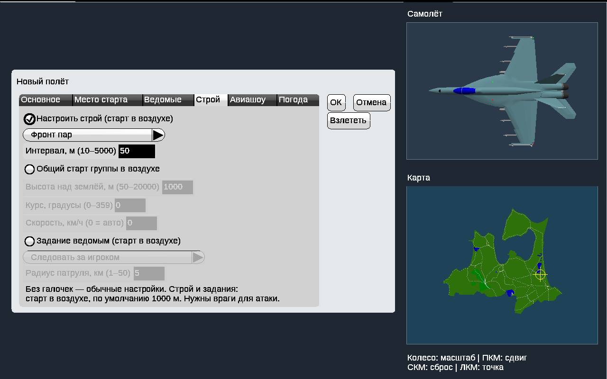
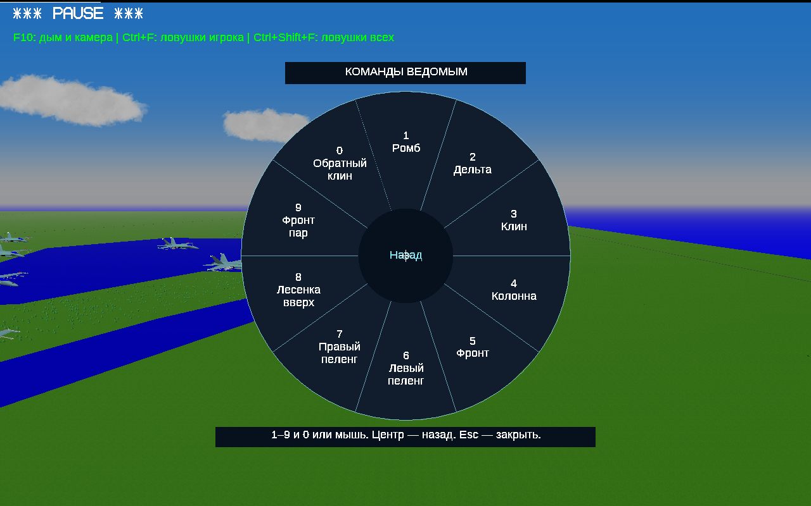
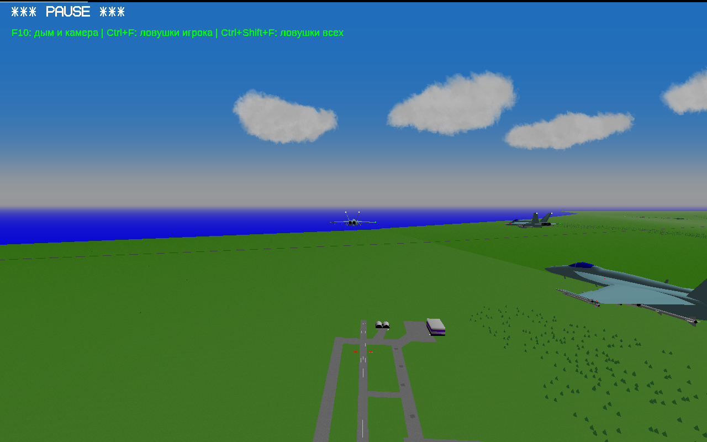

# YSFlight Airshow v8.6

## Разлёт без поворота навстречу

В v8.5 знак поворота был перепутан: левое и правое крыло группы поворачивали внутрь. Разлёт также переключал самолёты на автопилот без защиты от сближения, используемой в строю. Старую ошибку воспроизвели: в проверке ромба на Су-27 произошли столкновения.

В v8.6 ведомые выбирают уход наружу по своему фактическому положению. Во время ухода продолжают работать прогноз сближения с самолётами и защита от земли. Курс ухода самостоятельный: за дальнейшими манёврами игрока они не повторяют. Команда «Собраться» возвращает обычное следование.

В расширенной проверке обнаружено и исправлено пересечение путей при смене строя: теперь места распределяются по минимальной общей длине пути, а не жёстко по прежнему номеру. Номер и цвет остаются у самолёта. Это также предотвращает увеличение интервала из-за изменения назначения мест. При опасном сближении ведомый временно уступает место, затем снова занимает свою позицию. Запас включается при сходящихся траекториях, а не при спокойном параллельном полёте.

## Проверены все доступные строи

В колонне и вертикальной лесенке выход по очереди; в остальных строях — одновременно. Отдельно проверены сбор плотной колонны, сбор «Фронта пар» при другом курсе, последовательная смена всех строёв и повторная команда разлёта.

## Новый «Фронт пар» вместо двойной колонны

Две машины рядом, следующая пара позади и сдвинута на половину интервала. Игрок входит в первую пару. Строй доступен в настройке полёта и в круге команд.

## Установка и проверка у себя

Распаковать полный ZIP в **новую папку**, открыть `YSFlight_v8_6_32bit`, дважды нажать **ysflight32_gl1.exe**. Альтернатива — **ysflight32_gl2.exe**. Заголовок окна содержит **Airshow v8.6**. Сохраните рабочую v8.5; её предыдущие изменённые файлы также находятся в `backup_v8_5`.

Создайте новый полёт с восемью ведомыми, попробуйте «Рассыпаться» и «Собраться». Для нового построения выберите «Фронт пар». В старом сохранении старые позиции меняются после новой команды перестроения.

Игровые проверки выполнены Win64-сборкой того же кода под Wine. Выдаваемые EXE проверены как **PE32/i386, Windows GUI**, без CMD/BAT и внешних библиотек MinGW. Запуск новой сборки на настоящей Windows 10 32 бит проверяет пользователь. Испытания не являются гарантией отсутствия столкновений с любой моделью и при любых действиях игрока.

Картинки траекторий и схема — поясняющие рисунки по настоящим записям; последние три картинки — снимки самой игры. Подробные результаты и записи полётов приложены к исходникам.
