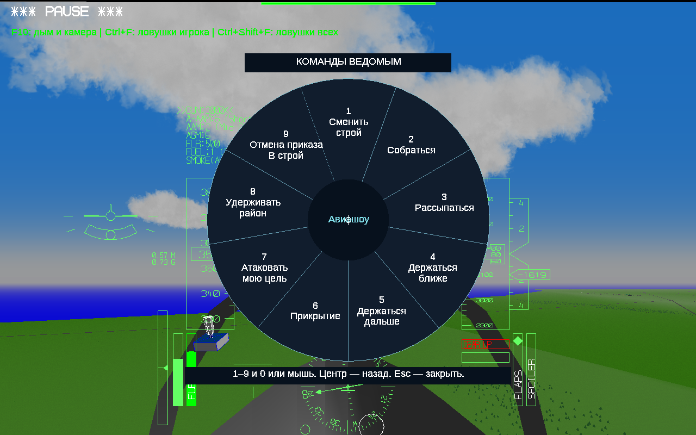

# YSFlight Airshow v8.7

## Строй заполняет пустые места

После потерь живые самолёты занимают компактный набор мест. Номера обновляются, цвет остаётся у своего самолёта. Проверено и после перемешивания мест при перестроении.

## Прикрытие уплотняется отдельно

У верхней группы нет вымышленного пустого места игрока: двое стоят по сторонам центра. При нечётном количестве в центре стоит настоящий самолёт. Игрок остаётся ниже.

## Индивидуальный разлёт

Уход наружу по плавной дуге; внешние машины расходятся шире. В колонне — по очереди, в остальных строях — одновременно. Возврат только по приказу «Собраться».

## Проверка всех строёв

Все восемь ведомых остались живы в каждом из десяти испытаний. Отдельно проверены потери, возврат и изменение количества прикрывающих.

## Круг команд

Настоящий снимок игры: Enter → 6, «Прикройте меня».

## Сколько самолётов отправить

Настоящий снимок игры: 1 — двое; 2 — четверо; 3 — все; 4 — вернуть прикрытие.

## Установка

Распакуйте полный игровой ZIP в новую папку **YSFlight_v8_7_32bit**. Дважды нажмите **ysflight32_gl1.exe**; альтернатива — **ysflight32_gl2.exe**. Сохраните рабочую v8.6. Предыдущие изменённые файлы находятся в `backup_v8_6`.

Проверьте новый полёт с 8 ведомыми и интервалом 50 м: разлёт, сбор, прикрытие двумя/четырьмя, возврат. Клавиши и лимиты сохранены. Старыe сохранения начинают с прежних мест; уплотнение выполняется после изменения состава или команды.

## Что проверено

Испытания реального полёта выполнены Win64-сборкой того же кода под Wine. Проверялись живые самолёты, дистанция между ними, фактические назначенные места, номера и цвета. Геометрия дополнительно прошла 5040 проверок расстояний: 10 строёв, 1–8 ведомых, основная и верхняя группы, интервалы 35,2 / 50 / 120 м.

Отдельно проверен разлёт колонны МиГ-29. Проверены выбор 2 → 4 → все → возврат; потери отдельно сверху и снизу; перехват воздушной угрозы и последующее восстановление верхней группы; потеря во время разлёта и сбор; настоящее меню прикрытия; продолжение того же полёта после двух Esc.

Выдаваемые EXE — **PE32/i386, Windows GUI**, без CMD/BAT и внешних библиотек MinGW. Запуск на настоящей Windows 10 32 бит проверяет пользователь. Эти испытания не гарантируют отсутствие столкновений при любых моделях и манёврах. Боевой перехват использует существующий ИИ YSFlight.

Картинки 1–4 — поясняющие схемы и траектории по данным игры; картинки 5–6 — настоящие снимки. Записи полётов, исходники проверок и результаты доступны в ZIP исходников.

## Идея на следующий этап

**«Партитура авиашоу»**: заранее составить последовательность «клин → дым → разлёт → сбор», затем запускать следующий шаг одной кнопкой. Можно добавить ожидание готовности строя. В v8.7 это предложение, функция пока не добавлена.
