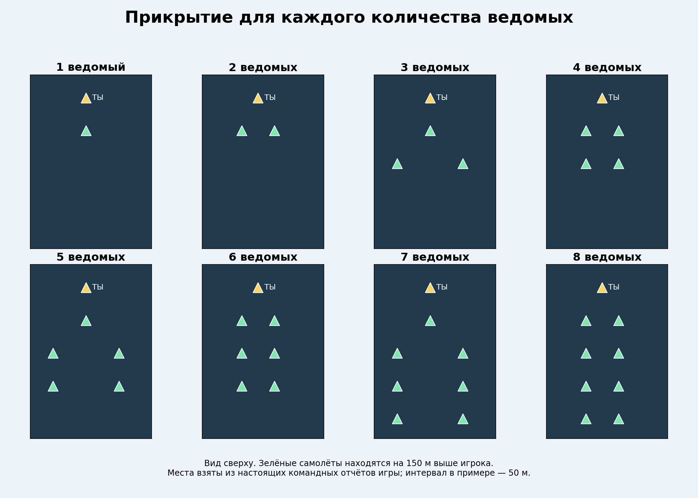
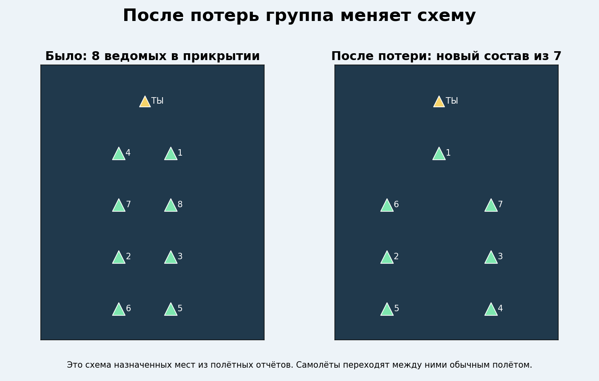
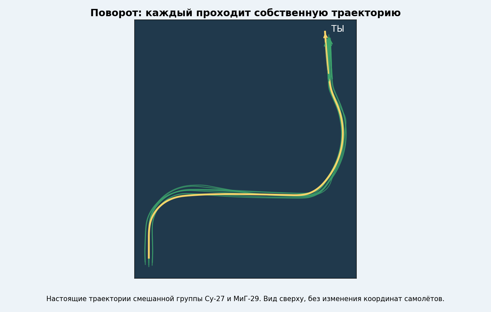
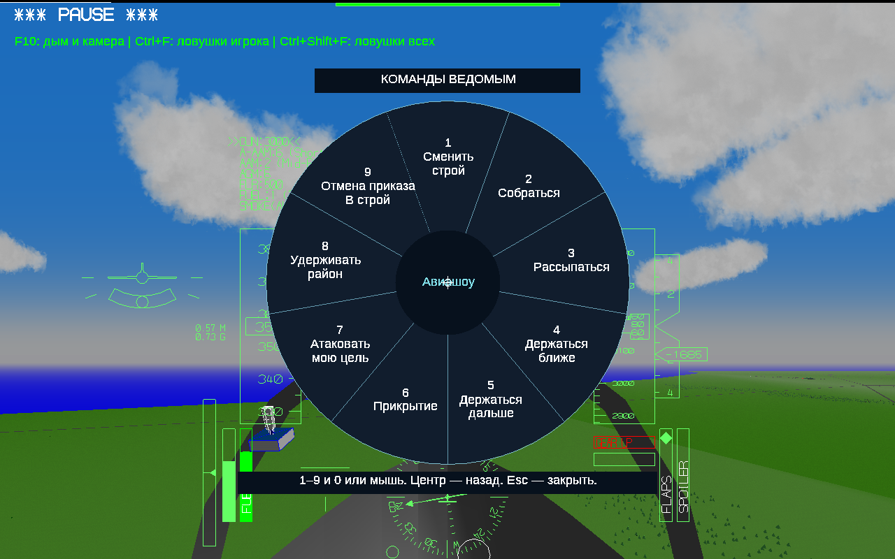
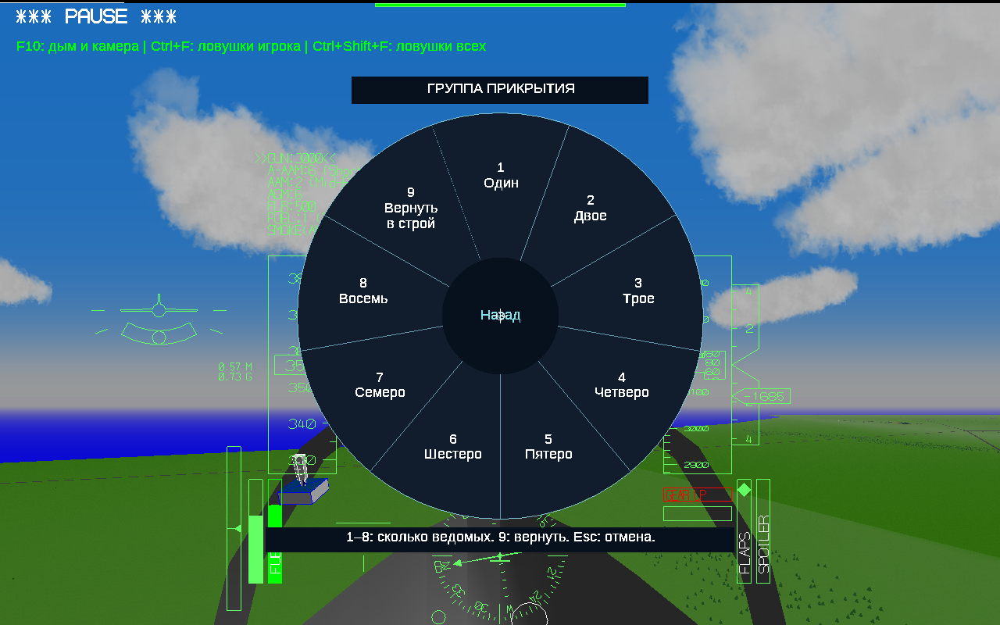
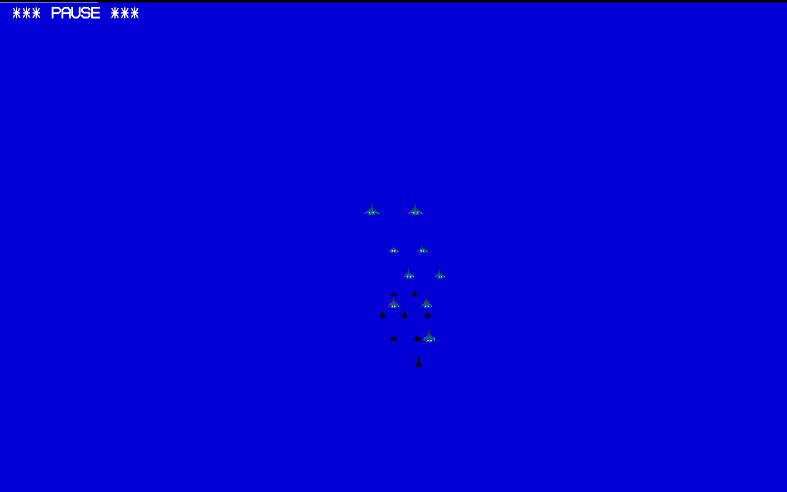

# YSFlight Airshow v8.8

## Все варианты прикрытия

Enter → 6 → число от 1 до 8. Чётный состав — пары; нечётный — передняя тройка и следующие пары. Один ведомый — отдельно. Схема прикрытия не зависит от основного строя.

## Места после потерь

Верхняя и нижняя группы уплотняются независимо. Номера меняются, цвета дыма остаются у своих самолётов.

## Полететь своим путём

При резком манёвре позиционное сближение мягче. Реакция на движение ведущего начинается сразу, сбор остаётся одновременным. Полёт выполняет существующая физика YSFlight.

## Открыть приказы

Настоящий снимок игры: Enter → 6.

## Выбрать количество

Настоящий снимок игры: 1–8 — сколько ведомых; 9 — вернуть прикрытие. Можно выбирать мышью.

## В самой игре

Настоящий снимок из проверки полёта на малой высоте. Чёрные силуэты — тени самолётов.

## Что изменилось в движении

Запрос набора высоты ограничен доступной тягой, сопротивлением, весом и запасом скорости самолёта. Сохранены ограничения крена и подъёмной силы, защита от земли и прогноз опасного сближения. Скорость регулирует штатный автопилот двигателем и доступными средствами торможения. Исправлен расчёт интервалов между фактическими местами частично отделённой группы.

В проверке торможения обнаружили слишком близкий подход к ведущему. После расширения упреждающего торможения контрольный полёт прошёл проверку дистанции.

Турбулентность и потеря визуального контакта не добавлялись. Новая аэродинамика не создавалась: используется физика YSFlight. Внешний вид построений — проект для игры, не подтверждённое боевое наставление.

## Проверки

Пройдены полёты: прикрытие двумя; потери сверху и снизу; потеря в разлёте и сбор; последовательный выбор всех восьми количеств, потеря после выбора восьми и возврат; набор и снижение; повороты и изменение скорости в смешанной группе Су-27/МиГ-29; снижение на малой высоте над OCEAN. Проверены живые самолёты, расстояния, фактические назначенные места, сохранение цветов и восстановление позиций. Отдельно проверены непрерывность движения и отсутствие длительного сваливания в записанных полётах.

Геометрия: 3360 проверок попарных расстояний для 1–8 ведомых, четырёх интервалов и всех десяти основных строёв. Настоящее меню проверено клавишами: выбор трёх прикрывающих, затем два Esc и продолжение с прежнего времени. Проверены клавиатура по умолчанию и развёрнутое окно при запуске.

Полётные проверки выполнены Win64-сборкой того же кода под Wine. Выдаваемые EXE проверены как PE32/i386, Windows GUI, без CMD/BAT и внешних библиотек MinGW. Запуск на настоящей Windows 10 32 бит проверяет пользователь. Проверки не охватывают все модели, все карты и любые манёвры; проверка малой высоты началась со 120 м над ровным океаном; ведущий управлялся штатным автопилотом со своей защитой от земли. Экстремальное ручное пикирование этим испытанием не проверялось.

Первые три картинки — схемы и траектории по данным игры. Последние три — снимки игры. Исходники проверок, журналы и записи полётов приложены к архиву исходников.

## Установка и проверка у себя

Распакуйте полный игровой ZIP в новую папку **YSFlight_v8_8_32bit**. Дважды нажмите **ysflight32_gl1.exe**. Альтернатива — **ysflight32_gl2.exe**. Старую рабочую v8.7 сохраните; предыдущие изменённые файлы также находятся в `backup_v8_7`.

Создайте полёт с восемью ведомыми и интервалом 50 м. Попробуйте прикрытие тремя, пятью и восемью самолётами, набор, снижение, повороты и торможение. Затем Enter → 6 → 9 для возврата. Для разлёта и сбора остаются прежние команды.
