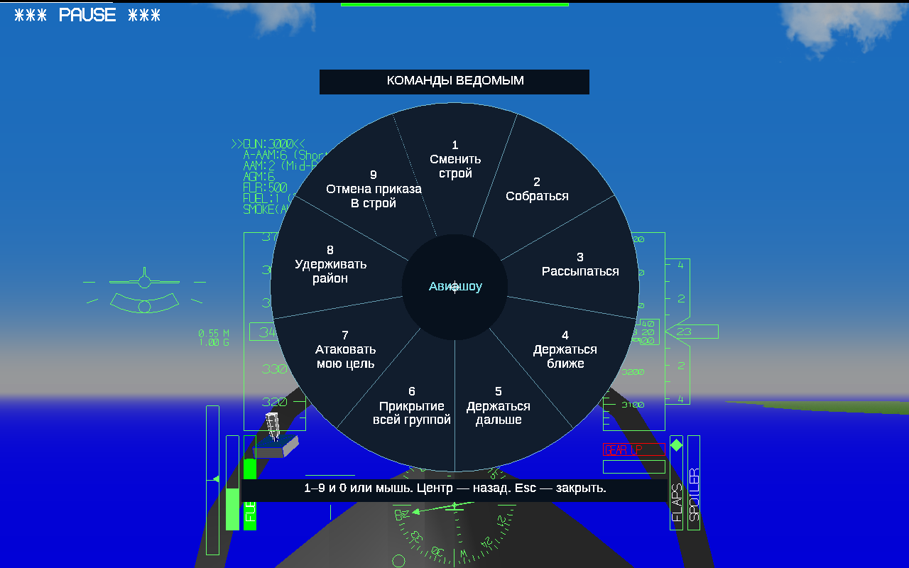
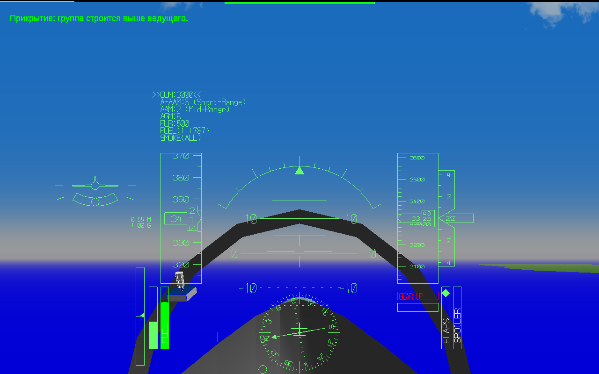
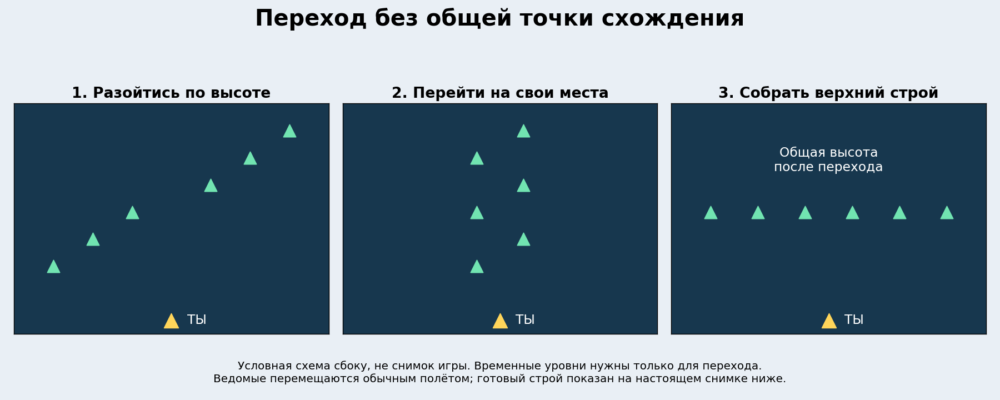
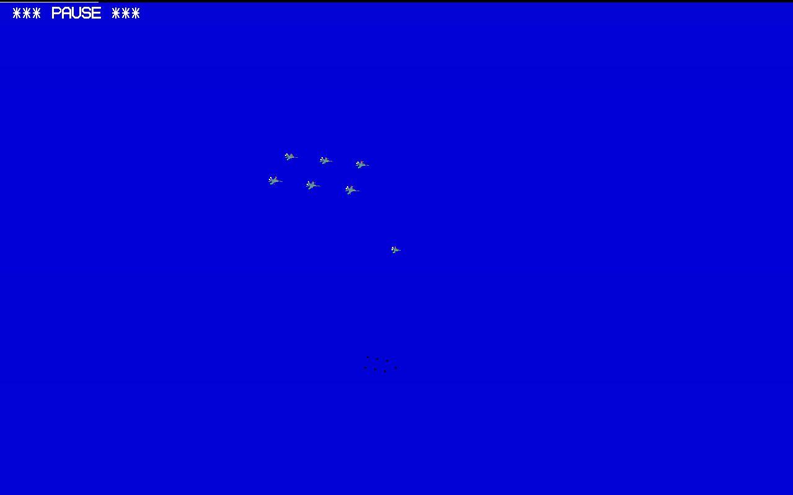
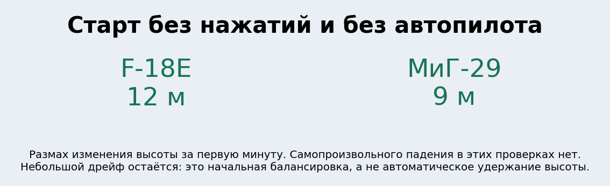
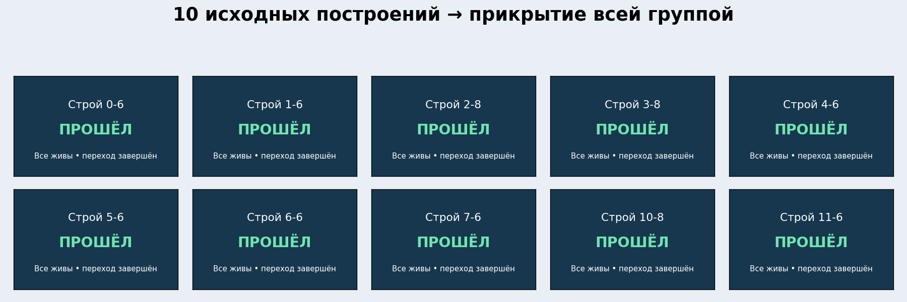

# YSFlight Airshow v8.9

## Одна команда — вся группа

Enter → 6. Все твои живые ведомые переходят в прикрытие. Повторная команда возвращает их в обычный строй. Выбора количества во время полёта больше нет.

## Приказ сразу выполняется

Настоящий снимок меню после команды. Количество задаётся перед полётом на вкладке «Ведомые».

## Как убрано схождение в центре

Сначала самолёты сохраняют свои горизонтальные места и расходятся по высоте. Затем меняют горизонтальные места на отдельных уровнях. После этого сходятся на общую высоту, уже находясь в разных местах.

## Шесть ведомых в прикрытии

Настоящий снимок после проверки через меню: все шесть наверху, игрок отдельно ниже. Чёрные силуэты внизу — тени.

## Старт без ухода вниз

Начальная скорость горизонтальная. Тангаж, триммер и тяга рассчитаны штатной физикой после установки всего снаряжения, включая дым. Непрерывного скрытого автопилота у игрока нет.

## Проверены переходы из десяти строёв

Реальные полётные проверки с шестью МиГ-29 или восемью Су-27, интервал 50 м. Проверены живые самолёты, дистанции, завершение перехода и занятие назначенных мест.

## Что исправлено

Убрано ошибочное деление группы на прикрывающих и остающихся рядом. Команда всегда использует всех живых ведомых, в том числе если старый сохранённый приказ содержал отдельное число. Возврат выполняется повторной командой или сбором.

Причина столкновений: прямое назначение конечных мест заставляло самолёты пересекаться по пути в центр. Теперь переход разделён на три этапа с временными уровнями. Возврат из прикрытия и изменение состава после потери также используют этот переход. Сохранённый незавершённый переход начинает безопасное распределение заново от фактических мест.

Причина начального снижения: нулевой тангаж и постоянная тяга не соответствовали скорости и весу снаряжённого самолёта. Начальная балансировка выполняется после оборудования самолёта, затем синхронизируются значения управления. Исправление применяется и при повторном старте старого ручного полёта. Запись полёта при просмотре не меняется.

## Что проверено и где пределы

Дополнительно пройдены возврат всей группы и потеря ведомого во время перехода. Проверка через настоящее меню: шесть ведомых, одно нажатие прикрытия, без выбора количества, без столкновений, переход завершён. Переход занимает время: в проверке через меню около 47 секунд. Временный набор разных высот является этапом перестроения, а не конечной «лесенкой».

Ручной старт проверен минутой без нажатий и без автопилота игрока на F-18E и МиГ-29. В остальных проверках переходов ведущий управляется штатным автопилотом, чтобы выдерживать одинаковые условия. Это не проверка всех моделей, всех интервалов и любых резких манёвров. При изменении скорости, массы и режима двигателя пилоту по-прежнему может потребоваться корректировать управление.

Полётные испытания выполнены Win64-сборкой тех же исходников под Wine. Выдаваемые EXE проверены как PE32/i386, Windows GUI; CMD/BAT для запуска нет. Настоящая Windows 10 32 бит в этой среде недоступна, окончательную проверку запуска делает пользователь. Обещать отсутствие столкновений при любых условиях нельзя; журналы и записи именно выполненных проверок сохранены в архиве исходников.

Турбулентность и систему потери визуального контакта не добавляли. Используется физика YSFlight. Это схема поведения для игры, не подтверждённое боевое наставление.

## Как установить и проверить

Распакуйте полный ZIP в новую папку YSFlight_v8_9_32bit. Дважды нажмите ysflight32_gl1.exe. Альтернатива — ysflight32_gl2.exe. Предыдущую рабочую игру сохраните; изменённые файлы v8.8 также находятся в backup_v8_8.

Создайте воздушный старт, выберите шесть ведомых и интервал 50 м. Первую минуту попробуйте лететь без управления. Затем Enter → 6: все шесть перейдут в прикрытие. Дождитесь конца перехода, повторите Enter → 6 для возврата. При необычном поведении пришлите модель самолёта, интервал и короткое видео.
